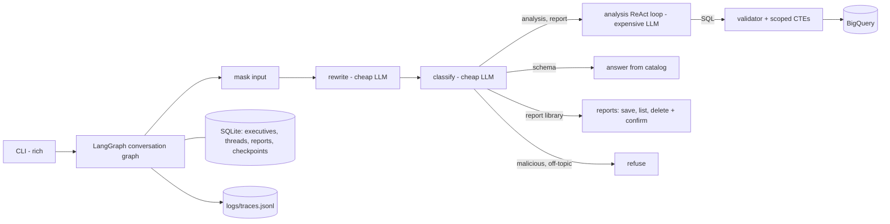

# RetailAgent

A command-line data analysis agent for a retail company's non-technical executives. An executive asks questions in plain English about sales, products and customers (BigQuery public dataset `thelook_ecommerce`), discusses the answers, and asks for a report with action items. Reports can be saved and deleted, by chat.

The prototype implements four requirements end to end: **safety and PII masking**, **high-stakes oversight** (confirmed deletion), **resilience and graceful errors**, and **observability**. The rest of the brief is design only and is described in the design document.

- Example session: [docs/example-run.md](docs/example-run.md) (real transcript and trace excerpts)
- Specification: [docs/design-decisions.md](docs/design-decisions.md) (DD)
- Interfaces: [docs/contracts.md](docs/contracts.md)
- Verified facts about the data and models: [docs/facts.md](docs/facts.md)
- **Production design:** [deliverables/hld.md](deliverables/hld.md) (High-Level Design with architecture diagrams) and [deliverables/technical-explanation.md](deliverables/technical-explanation.md) (reasoning, data flow, how each requirement is solved, error handling, observability, QA)

## Architecture in short



- **One agent, explicit graph** (DD §4): the flow branches by intent and loops (self-correction, clarification), so LangGraph fits better than a single pass.
- **Security is code, not prompts** (DD §7, §8). The model never sees the base tables. Every query runs over per-executive scoped CTEs (CEO: all brands, brand manager: their brands). A `sqlglot` validator rejects anything else (other tables, blocked PII columns, identifier plus demographics). Structured identifiers typed by the user are masked before any LLM call or log write.
- **Models are roles in `config.yaml`** (DD §3): `cheap` (rewrite, classify, schema and library answers) and `expensive` (analysis, reports), each a fallback chain.
- **Persona and prompts** are plain files in `content/` (DD §13).
- **Traces**: every node, LLM call, query, security event and turn goes to `logs/traces.jsonl` (DD §15).

## Setup

You need Python 3.11 or newer, a Google Cloud project with BigQuery enabled, the `gcloud` CLI, and a Gemini API key from [Google AI Studio](https://aistudio.google.com/apikey).

```bash
python3 -m venv .venv
```

```bash
source .venv/bin/activate
```

```bash
pip install -r requirements.txt
```

Authenticate to Google Cloud. The project you pick is billed for BigQuery query jobs; the public dataset itself is free to read, and a scoped query scans about 7 to 11 MB in the example run (see `docs/facts.md` §2; the on-demand free tier is 1 TiB per month).

```bash
gcloud auth application-default login
```

Create your local settings and fill in the project ID and the Gemini key. `.env` is git-ignored.

```bash
cp .env.example .env
```

| Variable | Meaning |
|---|---|
| `GOOGLE_API_KEY` | Gemini API key |
| `GOOGLE_CLOUD_PROJECT` | GCP project ID that runs the BigQuery jobs |
| `LLM_PROFILE` | `free` (recommended on a free key) or `standard` |
| `ANTHROPIC_API_KEY` | optional; adds Claude Haiku as the last fallback when set (needs the `langchain-anthropic` package) |

### Model profiles and free-tier limits

- `free`: both roles run on Flash-Lite. Answer quality is lower, but the daily request allowance is much larger, so a full demo fits on a free key.
- `standard`: Flash-Lite for rewrite and classify, Flash for analysis and reports. Free-tier Flash keys have a very small daily quota; use this profile with billing enabled.
- The official Gemini pages do not publish free-tier numbers. Read your own limits at `aistudio.google.com/rate-limit`. Reports of free-tier Flash-Lite are around 15 requests per minute, which the live eval scripts respect with `--rpm 14`.
- A per-minute limit is retried with backoff. A daily quota that is exhausted stops the turn with a clear message ("switch to `LLM_PROFILE=free`, or enable billing"); the session continues.

## Seed the demo executives

Creates the CEO and two brand managers with non-overlapping top brands, computed from your copy of the dataset. Safe to run again.

```bash
python scripts/seed_executives.py
```

## Run the CLI

```bash
python -m retail_agent --profile free
```

Or log in at start:

```bash
python -m retail_agent --exec ceo --profile free
```

Ask in natural language: "What was our total revenue last month, by product category?", "Why did it change compared with the month before?", "Write a report on this with action items.", "Save this report.", "Delete all reports that mention Diesel." (the agent lists the reports and waits for `confirm`), "What data do you have?".

Piped input also works (one line per turn, no spinner):

```bash
printf '%s\n' "What data do you have about products and orders?" "/quit" | python -m retail_agent --exec ceo --profile free
```

| Command | Purpose |
|---|---|
| `/login <exec_id>` | switch executive (`ceo`, `brand_manager_1`, `brand_manager_2`); starts a new conversation and clears a pending delete |
| `/new` | new conversation; clears a pending delete |
| `/resume <thread_id>` | continue an earlier conversation of the current executive |
| `/trace` | show the current `thread_id`, the trace file and the error log |
| `/feedback good\|bad [comment]` | log explicit feedback |
| `/quit` | exit |

Listing and deleting reports are natural-language requests, not commands.

If a turn fails (for example, every model in the fallback chain is rate-limited), the CLI prints one short message with the thread ID and the session continues. The full error with its traceback goes to `logs/agent.log`, and the turn's `error_type` to `logs/traces.jsonl`; both files are git-ignored. No stack trace is shown in the terminal.

## Change the tone without redeploying

Edit `content/persona.md` and save. The file is read at the start of each conversation (`/new`, `/login`, or a fresh start) and pinned for it, so tone stays stable inside a conversation. `/resume` keeps the persona the thread started with. The persona hash is written to every trace record. The persona controls tone and style only; safety rules always win (DD §13).

## Tests

```bash
pytest
```

The default run is offline (no LLM, no BigQuery) and must always pass. Markers:

```bash
pytest -m bq
```

needs GCP credentials and `GOOGLE_CLOUD_PROJECT` (scans a few MB per query). It also runs the `llm`+`bq` tests, which call Gemini; use `pytest -m "bq and not llm"` to keep the Gemini quota untouched.

```bash
pytest -m llm
```

needs `GOOGLE_API_KEY` and counts against the free-tier quota.

Deterministic attack and masking cases live in `eval/security_cases.yaml`; the tests load that file.

## Evaluation and observability scripts

Inspect one conversation (thread id or prefix, from `/trace`), with every node, LLM call, query, security event and turn summary:

```bash
python scripts/inspect_trace.py <thread_id>
```

Agent health over a time window: error rate by `error_type`, fallback and budget rates, security events by kind, p50/p95 latency per intent, tokens and estimated cost per turn, feedback counts:

```bash
python scripts/metrics.py --since 2026-10-25
```

Live evaluation (all use the real LLM and BigQuery; keep `--rpm` at or below your per-minute limit):

```bash
python scripts/run_routing_eval.py --rpm 14
```

```bash
python scripts/run_smoke.py --rpm 14
```

```bash
python scripts/run_golden.py --rpm 14 --limit 5
```

### Results

The golden set (`eval/golden_set.yaml`) is the evaluation set: 26 business cases (the client's example questions and the expected capabilities) and 12 security cases, run for each of the three executives. Reference SQL runs live through the same scoping, so the expected numbers follow the daily-regenerated data. A case passes when the key numbers match within a tolerance and the deterministic checks hold (definitions and date range stated, "no spike" when there is none, no blocked column in the executed SQL, no PII in the answer). It uses the Golden Bucket's trio format but is deliberately not part of the Golden Bucket, which is a seam in the prototype (HLD §4.3).

Last full run, 2026-10-26, `free` profile (Flash-Lite for every role, `--rpm 14`; details in `docs/review.md` §8.10–8.11). The `standard` profile has not been evaluated live.

| Check | Result |
|---|---|
| Offline tests (`pytest`) | 397 passed |
| BigQuery tests (`pytest -m "bq and not llm"`) | 107 passed |
| Routing (`run_routing_eval.py`, 60 labelled messages) | 98 % routed correctly; 0 of 47 legitimate questions refused |
| Golden set (`run_golden.py`) | **93/111 (84 %)**: business 66/78, security 27/33 |
| — CEO | 31/35 (business 22/26, security 9/9) |
| — `brand_manager_1` | 30/38 (business 21/26, security 9/12) |
| — `brand_manager_2` | 32/38 (business 23/26, security 9/12) |
| Smoke dialogues (`run_smoke.py`, 12) | 8/12 in the full run, partly during a quota outage; SM-04 passed on a rerun; SM-07, SM-08 and SM-11 passed in earlier runs and were not rerun |

What the misses are:
- **Business (12).** The answer leaves out a number or a definition the check looks for (a total, a leader's share, the partial-month note). The failing cases change from run to run, and none of them is a scoping or security failure.
- **Security (6).** S04 and S05 ask a brand manager for another brand's revenue. No data leaked: the agent said the brand was outside the scope, but through the model, not through the deterministic "no access" path the case checks. A code-level brand check was added afterwards (`get_column_values` stops the turn when a manager's brand search finds nothing); since then S04 passes for both managers and S05 for `brand_manager_2` (S05 for `brand_manager_1` not confirmed: Gemini timed out). S08 (delete without `confirm`) failed with an error in the full run and passed when run alone. The full golden set has not been rerun since the brand check.

Live numbers move: the dataset is regenerated daily, and free-tier Gemini returns frequent 429 and 503 responses, so a rerun can differ by a few cases.

## Known limitations

- **Narrow demographic groups** (DD §8.4). The validator blocks rows that combine a customer identifier with demographics, but a narrow filter such as a specific city, age and gender can still return an aggregate over a group of one. Closing this needs a minimum group size (k ≥ 5) with suppression, enforced in the data layer. It goes to the high-level design.
- **Quasi-identifier rule is heuristic** (DD §8.4, review M1, C, D, F). It is deterministic for the shapes it knows (customer ID next to demographics, also through aggregates, `UNNEST` and `ARRAY(...)`; filters by `=`, ranges, `IN`, `BETWEEN`; `PIVOT` rejected). Still open: linking by `order_id`, item ID or row order; selecting one customer by `ORDER BY ... LIMIT 1`, by a constant that comes through a CTE or subquery, by `LIKE`/`REGEXP`/`MOD`; demographics used only as filters next to an ID. The data is synthetic, and a production system needs k-anonymity in the data layer (HLD).
- **Brand literal checks** (review L9) do not cover `CONCAT`, `STARTS_WITH`, `REGEXP_CONTAINS` or `IN (SELECT 'Nike')`; the CTEs still return no out-of-scope rows, the user just gets an empty result instead of the "no access" message.
- **Deadline floor** (review L5): a call started with under 10 s left still gets the 10 s Gemini minimum, so a turn can overrun its deadline by a few seconds.
- **Names and free text in the input are not masked** (DD §8.5). Only emails, phone numbers (9+ digits) and Luhn-valid card numbers are masked. NER is not used on purpose: many brands in the dataset are personal names (Calvin Klein, Tommy Hilfiger), so NER would mask the brands. Text typed by the executive is their own disclosure; what is protected is the customer data in the database, and that is enforced by the data layer.
- **Free-tier reliability.** Gemini 429 and 503 "high demand" responses are frequent on free keys. The wrapper retries and falls back along the chain, but a turn can still fail with a clear error (details in `logs/agent.log`).
- **Answer quality on `free`.** Flash-Lite sometimes words limitations loosely (for example, saying "the executive's brands" to the CEO) and may need a rephrased question.
- **Third-party warnings.** `google-auth` and `langchain-google-genai` print `FutureWarning`/`UserWarning` lines to stderr.
- **Design-only items** stay seams: user preference memory, Golden Bucket retrieval, SSO, a production observability stack.

## Why LangGraph

I chose LangGraph because the conversation is a graph, not a chain: it branches by intent (analysis, schema, report library, refusal, clarification), loops back for query self-correction, and pauses for human confirmation before a deletion. LangGraph gives explicit nodes and edges, checkpointed thread state (SQLite) that survives `/resume`, `interrupt` for the confirmation step, and a node-level event stream that feeds the CLI progress line. Experience level: two years with LangGraph, three LLM agents in production at Similarweb, all built on it:

- **Activation Insights Agent** (LangGraph + MCP): two-model routing, a lightweight model for tool selection and parallel tool execution; cost per query down from $0.50 to about $0.06, latency from 50 s to about 14 s.
- **Multilingual Competitors Agent**: a parallel fan-out / fan-in graph for a latency-critical use case, with a single structured-output call.
- **RAG onboarding agent**: hybrid retrieval over PostgreSQL + pgvector (dense + full-text, weighted Reciprocal Rank Fusion), semantic routing and a Redis semantic cache; cost per request down about 10×, latency from 11–12 s to 3 s.

More on the framework choice and the alternatives considered: [technical explanation §1.3](deliverables/technical-explanation.md#13-framework-langgraph).
