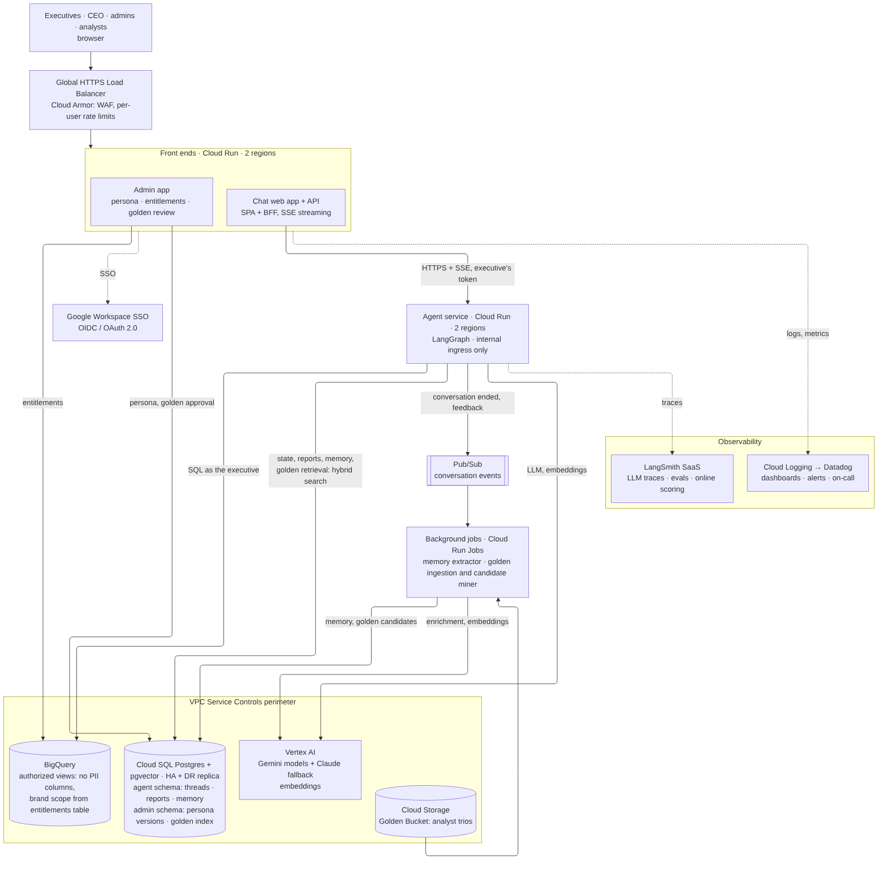
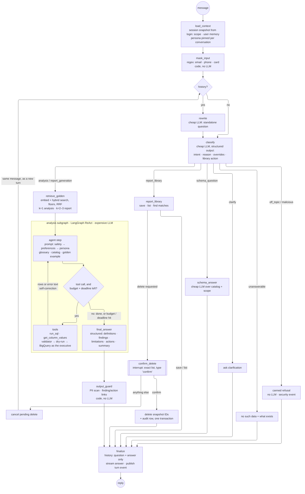
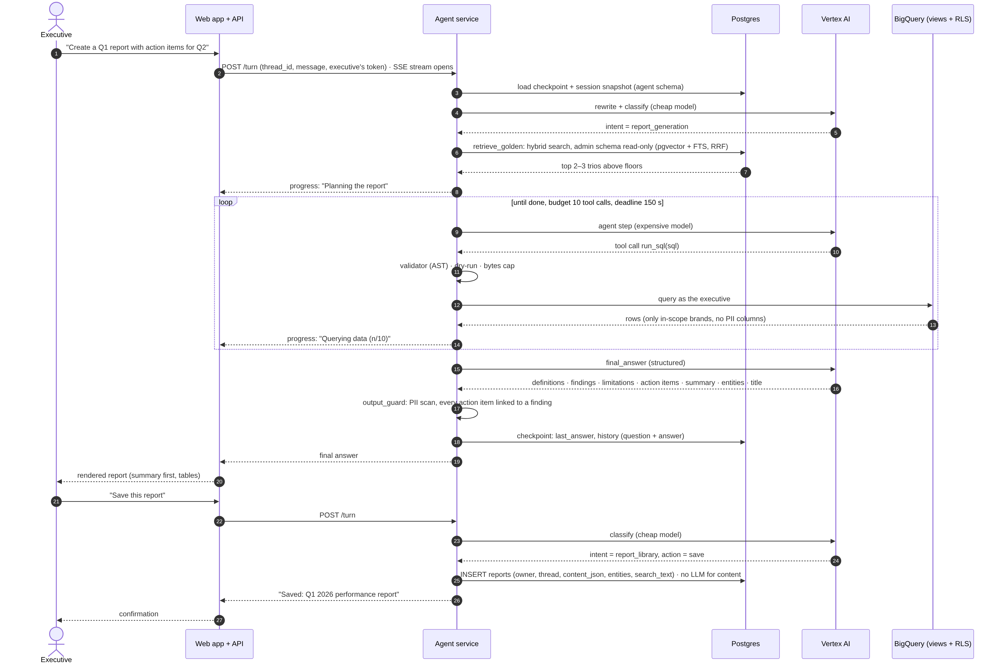
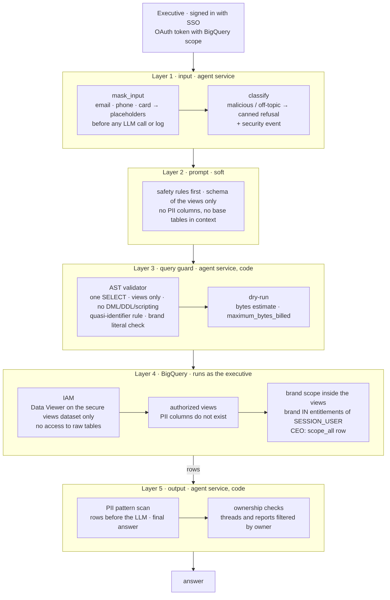
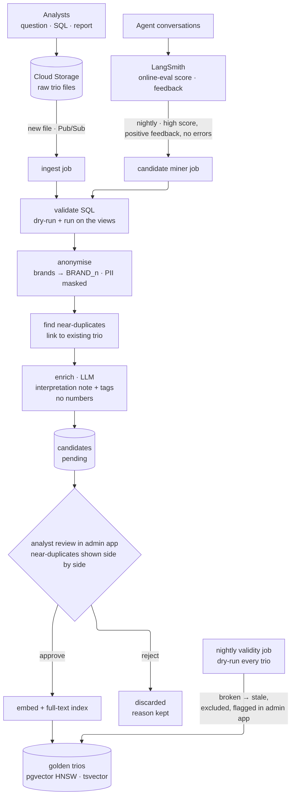
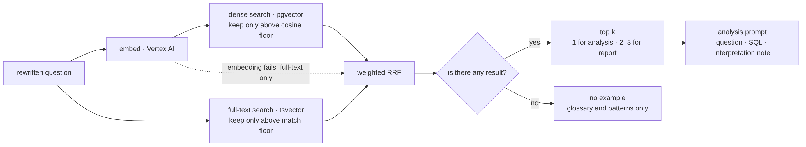
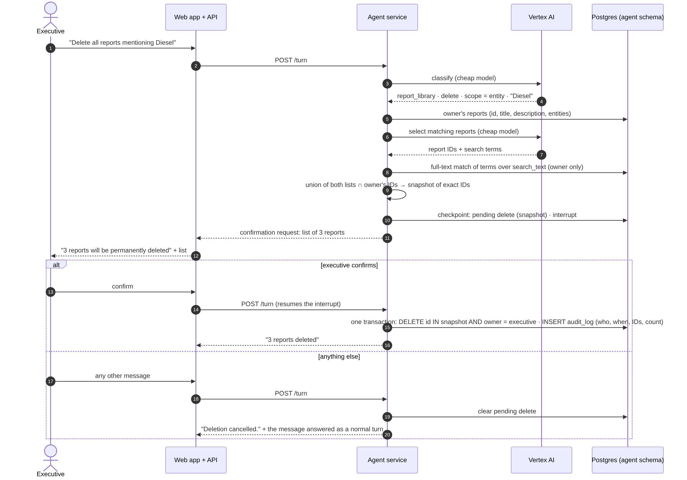

# Retail Data Analysis Agent — High-Level Design

Production design of a chat assistant that lets a retail company's executives ask questions about sales, products and customers in plain English, discuss the answers, and get reports with action items.

- How each requirement is solved in detail, error handling, observability, QA, setup: [technical-explanation.md](technical-explanation.md)
- Working prototype (CLI) and its specification: [README](../README.md), [docs/design-decisions.md](../docs/design-decisions.md)

---

## 1. Context and scope

### 1.1 What the system does

An executive opens a web chat, signs in with the company account and asks questions such as "Why are customers in state X underspending compared with state Y?" or "Create a Q1 report with action items for Q2". The agent:

- turns the question into SQL over the company's BigQuery warehouse and runs it **as that executive**, so they only ever see data of the brands they manage;
- uses the **Golden Bucket**, a library of past analyst work (question → SQL → interpretation), to approach the question the way analysts did before;
- answers with stated metric definitions, findings, limitations and, for reports, action items linked to findings;
- saves a report when asked and deletes reports only after a typed confirmation.

### 1.2 Users

| User | What they do | Data they can see |
|---|---|---|
| Brand manager (executive) | asks questions, creates, saves and deletes their own reports | only the brands assigned to them; customer and order data only through purchases of those brands |
| CEO | same as above | all brands |
| Admin | in the admin app: maintains brand assignments (entitlements) and the persona (tone of the agent), approves or rejects Golden Bucket candidates | no analysis data through the admin app |

Analysts are not users of the system: they only produce trio files for the Golden Bucket (section 4.3).

### 1.3 Requirements

| # | Requirement | Short name used below |
|---|---|---|
| 1 | Use past analyst work (Golden Bucket) at question time and keep it up to date | Hybrid intelligence |
| 2 | Analysis questions only; no PII in the output; each executive sees only their brands | Safety and PII |
| 3 | Destructive operations on saved reports need a strict confirmation | High-stakes oversight |
| 4 | Remember user preferences; improve the system from past interactions | Learning loop |
| 5 | Self-correct SQL errors and empty results; survive provider outages without crashing or inflating cost | Resilience |
| 6 | Evaluate before deployment: correctness, intent, UX | Quality assurance |
| 7 | Know when and why the agent fails; reconstruct any conversation | Observability |
| 8 | Non-developers change the agent's tone weekly without a redeploy | Persona management |

### 1.4 Assumptions

| Topic | Assumption |
|---|---|
| Scale | 50 executives, about 100 requests each per month (≈ 5,000 turns/month); low concurrency |
| Latency | an analytical answer in under 30 s with progress shown; a full report up to about 2.5 min, with live progress |
| Language | English |
| Cloud | Google Cloud; the company signs in with Google Workspace SSO |
| Warehouse | BigQuery; the four tables of `thelook_ecommerce` (`orders`, `order_items`, `products`, `users`) stand for the company's data |
| Regions | two US regions with failover; the warehouse is in the BigQuery US multi-region |
| Data residency | if the company operates in the EU and GDPR requires EU residency, the whole stack (warehouse, database, models, logs) is deployed in EU regions instead; the design does not change |

### 1.5 Out of scope

- Charts, e-mailing and exporting reports. These are further branches of the report flow that take a saved report and deliver it differently; the graph is built so they can be added as nodes without changing the rest.
- Automated changes to prompts from failure analysis. Prompt and glossary changes go through a normal pull request and the evaluation gate (section 7).

---

## 2. System overview



<sub>Source: [diagrams/system-overview.mmd](diagrams/system-overview.mmd)</sub>

### 2.1 How a question flows, in five steps

1. The browser sends the question to the **chat web app** through the global load balancer. The executive is already signed in with Google Workspace; the web app holds their short-lived OAuth token (BigQuery scope).
2. The web app forwards the question and the executive's token to the **agent service** and streams the agent's progress back to the browser (Server-Sent Events).
3. The agent runs its LangGraph graph: it routes the question with a cheap model, retrieves similar analyst work from the Golden Bucket, and runs an analysis loop with a stronger model that writes SQL.
4. Every SQL query is checked in code and then executed in **BigQuery as the executive**. The executive's queries can only reach views that contain no PII columns and filter rows to their brands, so the database itself enforces the access rules.
5. The agent checks the final answer (PII scan, every action item linked to a finding), stores the conversation state in **Postgres**, streams the answer, and publishes a "turn finished" event. Background jobs use these events to update the user's memory and to find candidate trios for the Golden Bucket.

### 2.2 Components

| Component | Service | Responsibility | Why this service | Alternative considered |
|---|---|---|---|---|
| Edge | Global external HTTPS load balancer + Cloud Armor | one entry point for both regions, failover, firewall rules, per-user rate limits | routes to the healthy region automatically; Cloud Armor rate limiting replaces a separate rate-limit store | a regional load balancer cannot fail over between regions |
| Chat web app + API | Cloud Run, two regions | sign-in, chat UI, streaming of agent events to the browser; no business logic, no database access | serverless containers with streaming support; no cluster to run for 50 users | GKE: running a cluster is not justified at this scale |
| Admin app | Cloud Run | entitlements, persona versions, Golden Bucket review | same platform as the web app | a separate CMS for the persona: one more system for little benefit |
| Agent service | Cloud Run, two regions, internal ingress only | the LangGraph agent; the only service that talks to BigQuery, Vertex AI and the agent's Postgres schema | scales and releases independently of the UI; not reachable from the internet; any instance can continue any conversation because state lives in Postgres | Vertex AI Agent Engine: managed, but less control over passing the executive's token and over streaming |
| Identity | Google Workspace SSO (OIDC / OAuth 2.0) | who the user is; a token BigQuery understands | `SESSION_USER()` in BigQuery returns the executive, so access rules can live in the database | another identity provider via Workforce Identity Federation: works, adds a layer |
| Warehouse | BigQuery: authorized views + entitlements table | the analysis data; PII removal and brand scope enforced in the views | the data already lives there; views enforce access for whoever runs the query | scoping only in agent code: one bug would expose other brands |
| Models | Vertex AI: Gemini 3.5 Flash-Lite (routing), Gemini 3.8 Flash (analysis), Claude via Vertex AI (fallback), Gemini Embedding | routing, SQL writing, synthesis, embeddings | IAM instead of API keys, enterprise data terms, regional endpoints, inside the VPC Service Controls perimeter; a second model family under the same billing | Google AI Studio: developer-oriented, API keys |
| App database | Cloud SQL for PostgreSQL + pgvector, high availability + cross-region replica | conversation state, saved reports, user memory, persona versions, Golden Bucket index | one store for relational data, full-text search and vectors; a deletion and its audit row commit in one transaction | Firestore + a separate vector database: two more services and no transactions across them |
| Golden Bucket files | Cloud Storage | analysts drop trio files; a new file triggers ingestion | simple, event notifications to Pub/Sub | — |
| Events | Pub/Sub | "turn finished", "conversation ended", "feedback" events for background jobs | keeps memory extraction and mining out of the user's request path | doing the work inside the turn: more latency and LLM cost per answer |
| Background jobs | Cloud Run Jobs + Cloud Scheduler | memory extraction, Golden Bucket ingestion, candidate mining, nightly validity check | same container platform as the services | Dataflow: overkill for this volume |
| LLM observability | LangSmith (SaaS) | traces of every LLM call and tool call, offline evaluation, online scoring of live traffic | built for LangGraph; I use it in production for tracing and evaluation | Cloud Trace only: no prompt-level view or evaluation tooling |
| Service observability | Cloud Logging → Datadog (dashboards, alerts, on-call) | service health, error rates, latency, alerting | Cloud Logging collects everything GCP emits by default; Datadog for dashboards, alerts and on-call because I run it in production today | Cloud Monitoring alone: works, but no hands-on operating experience with it |
| Perimeter | VPC Service Controls | BigQuery, Vertex AI, Cloud SQL and Cloud Storage inside one perimeter | data cannot be copied to a project outside the perimeter, even with stolen credentials | — |

### 2.3 Communication between components

| From → to | Protocol | Identity used | Notes |
|---|---|---|---|
| Browser → web app / admin app | HTTPS via the load balancer | Google Workspace sign-in (OIDC) | Cloud Armor applies rate limits per user |
| Web app → agent service | HTTPS, response streamed as Server-Sent Events | service-to-service ID token; the executive's OAuth token passed along | the agent accepts requests only from the web app |
| Agent → BigQuery | BigQuery API | **the executive's OAuth token** | views filter by `SESSION_USER()`; every query is labelled with thread and turn ID for cost attribution |
| Agent → Vertex AI | Vertex AI API | agent service account | regional endpoint in the same region, the other region as fallback |
| Agent → Postgres | private IP | `agent` database user | read/write on the agent schema, read-only on the admin schema |
| Admin app → Postgres | private IP | `admin` database user | read/write on the admin schema only |
| Admin app → BigQuery | BigQuery API | admin service account | writes the entitlements table only |
| Agent → Pub/Sub → jobs | Pub/Sub push to Cloud Run Jobs | service accounts | asynchronous; a failed job retries without affecting users |
| Agent → LangSmith | HTTPS | API key from Secret Manager | traces leave the perimeter; they contain no PII (section 5) |

---

## 3. Agent graph

The agent is one LangGraph graph per conversation thread. Routing and guard steps are deterministic code or one cheap model call; only the analysis subgraph uses the stronger model.



<sub>Source: [diagrams/agent-graph.mmd](diagrams/agent-graph.mmd)</sub>

### 3.1 Nodes

| Node | What it does | Code or model |
|---|---|---|
| `load_context` | reads the session snapshot taken at login (brand scope, user memory) and pins the persona version at the first turn of a conversation | code |
| `mask_input` | replaces e-mails, phone numbers and card numbers in the message with placeholders before any model call or log write | code |
| `rewrite` | turns a follow-up ("and for state Y?") into a standalone question; skipped on the first turn | cheap model |
| `classify` | picks the intent: analysis, report generation, report library, schema question, clarification, unanswerable, off-topic, malicious; extracts metric overrides and the library action | cheap model, structured output |
| `retrieve_golden` | hybrid search over approved Golden Bucket trios; adds the best 1 (analysis) or 2–3 (report) examples to the prompt, or none | code + embedding call |
| analysis subgraph | ReAct loop: the model writes SQL, tools validate and run it, errors go back to the model for self-correction, until the answer is ready or the budget or deadline runs out | strong model + tools |
| `output_guard` | scans the answer for PII patterns; checks that every action item points to an existing finding | code |
| `schema_answer` | answers "what data do you have?" from the catalog and the executive's scope | cheap model |
| `report_library` | saves the last answer, lists reports, or finds reports to delete | code; cheap model only to select reports by topic |
| `confirm_delete` | pauses the graph (`interrupt`) with the exact list of reports and waits for `confirm` | code |
| clarify / unanswerable / refusal | asks one clarifying question, explains that the data does not exist, or refuses with a fixed text | code |
| `finalize` | stores the turn in history (question and final answer only), streams the reply, publishes the "turn finished" event | code |

### 3.2 Prompt assembly

The analysis prompt is built in a fixed order. Earlier blocks win on conflict:

1. **Safety rules**: analysis questions only, answer only from query results, no PII, no other brands, demographics only in aggregates. Neither the persona nor user preferences can change them.
2. **User preferences** from memory (format, depth, tables or bullets). Agreed with the client: preferences beat the persona.
3. **Persona**: tone and style, pinned for the whole conversation.
4. **Context**: the schema of the secure views, the metric glossary with session overrides, today's date, the executive's brands, the Golden Bucket examples.
5. **History**: the last 6 turns, each as question and final answer only. Raw query results never carry over to the next turn, which keeps prompts small and stops old numbers from mixing with new ones.

### 3.3 Limits per turn

| Limit | Analysis | Report |
|---|---|---|
| Tool calls (includes retries after errors) | 6 | 10 |
| Turn deadline | 60 s (target under 30 s) | 150 s |
| Synthesis reserve | 20 s | 20 s |

When the budget or the deadline runs out, no new query starts and the model writes the answer from what it has, listing the gaps under limitations. A partial answer is better than an error.

### 3.4 State and persistence

- **Checkpointer**: LangGraph Postgres checkpointer in the agent schema. Every node commits its state, so any agent instance in either region can continue a conversation, and a pending delete confirmation survives a restart.
- **Thread ownership**: each thread stores its owner. Opening another executive's thread answers "not found" without revealing that it exists.
- **Session snapshot**: brand scope and memory are read once at login. A stale snapshot is not a security problem: BigQuery applies the current entitlements on every query.

### 3.5 Extensibility

- A new analysis capability (for example, web trend search) is a new **tool** in the analysis subgraph.
- A new action (for example, e-mailing a saved report) is a new **branch** after `report_library`.
- Destructive operations are **never** tools the model can call. They are deterministic branches with an `interrupt` for confirmation.

---

## 4. Key flows

### 4.1 Creating and saving a report



<sub>Source: [diagrams/report-flow.mmd](diagrams/report-flow.mmd)</sub>

- Progress is streamed at every step ("Planning the report", "Querying data (3/10)"), so a report that takes two minutes never looks stuck.
- The final answer is structured: metric definitions used (with the concrete date range), findings with the queries behind them, limitations, action items each linked to a finding, summary, named entities, title. Action items without a finding are impossible by schema.
- Saving happens only on explicit request and costs no extra model call for the content: the last answer is already in the conversation state. A saved report is a frozen snapshot of results; a different period is a new report.

### 4.2 Secure data access



<sub>Source: [diagrams/secure-data-access.mmd](diagrams/secure-data-access.mmd)</sub>

Layers 1–3 make the agent behave well; layer 4 keeps the data safe **even if layers 1–3 fail**, because the database enforces access for the person who runs the query.

**Datasets.** `raw` holds the base tables and is readable only by data engineering. `secure` holds authorized views; executives get read access to `secure` only. `governance` holds the entitlements table, written only by the admin app.

**Views.** The views expose the analysis columns only (no names, e-mails, street addresses, postal codes or coordinates) and filter by the brands of whoever runs the query:

```sql
-- governance.entitlements(email STRING, brand STRING, scope_all BOOL); the CEO has one row with scope_all = TRUE

CREATE VIEW secure.products AS
SELECT p.id, p.category, p.name, p.brand, p.department, p.cost, p.retail_price
FROM raw.products AS p
WHERE EXISTS (
  SELECT 1 FROM governance.entitlements AS e
  WHERE e.email = SESSION_USER() AND (e.scope_all OR e.brand = p.brand)
);

CREATE VIEW secure.order_items AS            -- only items of in-scope products
SELECT oi.id, oi.order_id, oi.user_id, oi.product_id, oi.status,
       oi.created_at, oi.shipped_at, oi.delivered_at, oi.returned_at, oi.sale_price
FROM raw.order_items AS oi
JOIN secure.products AS p ON p.id = oi.product_id;

-- secure.orders: order_id, user_id, created_at of orders that contain in-scope items
-- secure.users: id, age, gender, city, state, country, traffic_source, created_at of customers who bought in-scope items
```

- `orders` exposes only three columns. Order-level fields such as the number of items or the order status describe other brands' items in the same basket and would leak them; item-level status and dates come from `order_items`.
- The agent never sees the `raw` dataset, not even in its prompt.
- The code validator stays in front of BigQuery as defense in depth: one `SELECT` only, `secure` views only, no PII columns, no customer ID next to demographics, and a dry-run with a bytes cap to stop runaway queries. Its rejections go back to the model as plain messages, so the model can rewrite the query.

### 4.3 Golden Bucket

**Ingestion and review.** Two sources feed one pipeline: analysts' files, and agent conversations that scored above the online-evaluation threshold **and** received positive feedback. Nothing reaches the index without an admin's approval.



<sub>Source: [diagrams/golden-ingestion.mmd](diagrams/golden-ingestion.mmd)</sub>

- **Validate**: the SQL is dry-run and run on the `secure` views with a pipeline service account that has an all-brands entitlement. Broken SQL never becomes an example.
- **Anonymise**: brand names become placeholders (`<BRAND_1>`), PII patterns are masked. The Golden Bucket itself holds no brand-specific data, so an example retrieved for one brand manager cannot leak another brand.
- **Near-duplicates** are linked to the existing trio and shown side by side; the admin keeps one or both.
- **Enrich**: a model writes a short interpretation note (which definitions were chosen, the steps, the caveats) and tags. It never copies numbers from the analyst's report: the reasoning is kept, the data is not.
- **Review**: an admin approves the complete trio, note included, so no unreviewed model text enters the index.
- **Validity**: a nightly job dry-runs every trio against the current views (free in BigQuery); broken trios are marked stale, excluded from retrieval and flagged in the admin app. The same check runs in CI when a view or the glossary changes.

**Retrieval at question time.**



<sub>Source: [diagrams/golden-retrieval.mmd](diagrams/golden-retrieval.mmd)</sub>

- Retrieval is a fixed node before the analysis, not a tool the model may skip.
- Dense search (pgvector, HNSW) matches how executives phrase questions; full-text search matches exact terms such as "RFM", "AOV" or "churn". Both run in one Postgres query.
- Each list keeps only results above its own relevance floor **before** fusion: Reciprocal Rank Fusion only ranks, so without floors it would always return something, and an irrelevant example is worse than none.
- If the embedding call fails, retrieval continues with full-text search only; if nothing passes the floors, the analysis runs with the glossary alone.
- The prompt receives the question, SQL and interpretation note, never the analyst's figures. Retrieved trio IDs and scores go to the trace; the executive does not see them.
- Evaluation cases are never in the index, so evaluation results are not inflated by the agent finding its own test answers.

### 4.4 Deleting reports



<sub>Source: [diagrams/deletion-flow.mmd](diagrams/deletion-flow.mmd)</sub>

- **Finding the reports.** "From this conversation" is a filter by thread, with no model call. "Mentioning X" combines a cheap-model selection with a full-text match over the full report text, because a report wrongly listed is visible in the confirmation while a report missed is invisible. Only the executive's own reports are ever candidates.
- **Snapshot.** The exact IDs are frozen in the conversation state. `confirm` deletes exactly those IDs, so a report saved between the question and the confirmation is never deleted by surprise.
- **Typed confirmation**, as in tools that make you type a resource's name before deleting it. The confirmation is valid for the next message only. Anything else cancels it, shows "Deletion cancelled." and the message is answered as a normal turn, so a question typed instead of `confirm` is not lost.
- **Hard delete.** The deletion and its audit row (who, when, report IDs, count, never the content) commit in one transaction. The report is gone immediately; copies in database backups (7 days) and LangSmith traces (14 days) expire by retention, and the conversation history is not a restore path.

---

## 5. Data storage and retention

No customer PII is stored anywhere in this system: it never leaves the `raw` dataset, so it cannot reach the agent, the database, the traces or the logs. E-mails, phone numbers and card numbers typed by an executive are masked before any model call or log write.

| Data | Store | Written by | Read by | Retention |
|---|---|---|---|---|
| Analysis data | BigQuery `raw` | data engineering pipelines | `secure` views only | company policy |
| Secure views | BigQuery `secure` | data engineering (view definitions) | executives, through the agent, with their own token | — |
| Entitlements (executive → brands) | BigQuery `governance` | admin app | the `secure` views; the agent at login, through a `secure.my_scope` view that returns only the caller's own brands | until changed |
| Conversation state, history, pending confirmations | Postgres, agent schema | agent | agent | 30 days after the last message |
| Session snapshot (scope, memory) | Postgres, agent schema | agent at login | agent | until the session expires |
| Saved reports | Postgres, agent schema | agent, on explicit request | agent, owner only | until the owner deletes them (hard delete) |
| Audit log of deletions | Postgres, agent schema | agent | operators | 1 year; metadata only, never report content |
| User memory (preferences) | Postgres, agent schema | memory job | agent; the user sees and deletes it on a settings page in the web app, through the agent API | until the user deletes it; bounded size |
| Persona versions | Postgres, admin schema | admin app | agent (read-only) | all versions kept, for history and rollback |
| Golden trios, candidates, search index | Postgres, admin schema | Golden Bucket jobs, admin app | agent (read-only) | until removed; stale trios excluded from retrieval |
| Golden Bucket source files | Cloud Storage | analysts | ingestion job | company policy |
| LLM traces | LangSmith | agent, jobs | engineers | 14 days (base retention) |
| Service logs and metrics | Cloud Logging → Datadog | all services | engineers, alerts | 30 days |
| Database backups | Cloud SQL automated backups + point-in-time recovery | Cloud SQL | operators | 7 days |

---

## 6. Requirements → design

Each requirement is explained in full, with what the prototype implements, in the [technical explanation](technical-explanation.md).

| # | Requirement | How the design solves it | Where |
|---|---|---|---|
| 1 | Hybrid intelligence | approved trios (question, SQL, interpretation note) retrieved by hybrid search before every analysis; fed by analysts' files and by well-rated conversations; admin approval, nightly validity check | 3.1, 4.3 |
| 2 | Safety and PII | intent classification refuses non-analysis requests; queries run as the executive on views without PII columns and filtered to their brands; code validator, PII scan of results and answers; ownership of threads and reports | 3.1, 4.2, 5 |
| 3 | High-stakes oversight | deletions only through a deterministic branch: exact list, typed `confirm`, snapshot of IDs, owner check, audit row in the same transaction | 4.4 |
| 4 | Learning loop | per user: a background job keeps a bounded memory of preferences, used in every prompt above the persona; system level: well-rated conversations become Golden Bucket candidates | 3.2, 4.3 |
| 5 | Resilience | SQL errors and empty results go back to the model within a tool budget and a deadline; partial answers instead of errors; model fallback chain; two regions; failures never crash the UI | 3.3, 7 |
| 6 | Quality assurance | offline evaluation sets as a release gate in CI, online scoring of live traffic in LangSmith, user feedback | 7 |
| 7 | Observability | every LLM and tool call traced in LangSmith by thread and turn; service metrics and alerts in Datadog | 2.2 |
| 8 | Persona management | the admin app stores versioned persona text; a quick model check that it changes tone only; pinned per conversation; no redeploy | 3.2, 5 |

---

## 7. Deployment and operations

**Regions.** The web app, admin app and agent run on Cloud Run in `us-central1` and `us-east1` behind the global load balancer, active-active; a region that fails health checks stops receiving traffic. Cloud SQL runs in `us-central1` with a standby in a second zone (automatic failover) and a cross-region replica in `us-east1`, promoted if the whole region is lost. BigQuery's US multi-region is replicated by Google. Each agent instance calls Vertex AI in its own region and falls back to the other region.

**Release.** Code, prompts and the glossary live in one repository. A pull request runs:

1. offline tests (validator, scoping, deletion flow, masking; no model calls);
2. the evaluation gate on a staging environment: the security set must pass 100 %, and the business golden set must score no lower than the current production version, within a tolerance band for model non-determinism;
3. deployment to Cloud Run as a new revision that first receives a small share of traffic, then all of it.

Infrastructure is defined in Terraform; secrets (the LangSmith key) are in Secret Manager. Service accounts replace API keys everywhere else.

**Changes without a redeploy.** The persona and the entitlements change in the admin app; the Golden Bucket changes through its pipeline. Prompts and the glossary change through a pull request and the gate above, because they affect correctness.

---

## 8. Cost estimate

For 50 executives × 100 requests per month (5,000 turns: 55 % analysis, 5 % reports, 40 % short turns such as saving a report or a clarification). Tokens per turn are measured on the prototype's traces (analysis ≈ 17k input and 0.6k output tokens on the analysis model; report ≈ 46k and 2.2k), with a 1.5× margin and output tripled for reasoning tokens. Model prices are Vertex AI list prices, with Gemini 3.8 Flash at its standard price from January 2027. Infrastructure prices are approximate list prices, to be confirmed in the GCP pricing calculator.

| Item | $/month |
|---|---|
| Models: Gemini 3.8 Flash (analysis), Gemini 3.5 Flash-Lite (routing) | ~210 |
| Background model calls: memory, enrichment, online scoring, embeddings | ~15 |
| BigQuery: ≈ 0.4 TiB scanned, inside the free 1 TiB per month | ~0 |
| Cloud Run: agent kept warm in both regions, web app, admin app, jobs | ~300 |
| Cloud SQL: high availability + cross-region replica | ~375 |
| Load balancer, Cloud Armor, Pub/Sub, Cloud Storage, Cloud Logging | ~70 |
| LangSmith Plus: 5 seats, traces within the included 10k | ~195 |
| Datadog | existing contract |
| **Total** | **~1,170 (≈ $23 per executive, ≈ $0.23 per turn)** |

About two thirds of the cost is fixed infrastructure bought for reliability (two regions, a highly available database). Model cost grows linearly with usage and is kept low by routing with a cheap model, a tool budget per turn, and short prompts (history as question and answer only).

---

## 9. Known limitations and next steps

| Limitation | Impact | Next step |
|---|---|---|
| A very narrow demographic filter (one city, age and gender) can return an aggregate over a single customer | partial re-identification risk; customer ID next to demographics is already blocked | a minimum group size enforced in the data layer |
| Memory learned today is used from the next login; a brand reassignment shows in the prompt only after the next login | wording of the scope in the answer may be stale; access is always current because the views check entitlements on every query | refresh the snapshot when the admin app changes an entitlement |
| Cross-region database failover is a replica promotion | a few minutes of downtime and possible loss of the last seconds of writes if a whole region fails | automate the promotion runbook |
| LangSmith runs outside the perimeter | traces hold aggregated business figures (no PII) | self-host LangSmith if company policy requires it |
| The fallback model (Claude) is rarely exercised | answer quality during an outage is less proven | run the golden set on the fallback model in the nightly evaluation |
