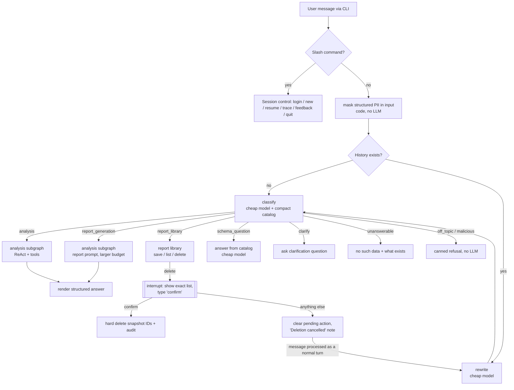

# Design Decisions

Decisions reached in the design interview (2026-10-23) on top of the client clarifications in `claude/clarifications.md`, updated after the gap review (2026-10-25). This is the specification of the working prototype; the production HLD and technical explanation are a separate document, and inputs for it are collected in [Open items](#20-open-items).

Question numbers (Q1–Q64) refer to the interview rounds; R-numbers (R1–R14) refer to the gap review. Where a later answer replaced an earlier one, only the final decision is described in the body; the history is in [Superseded decisions](#19-superseded-decisions).

---

## 1. Guiding principles

1. **Simple code, deep documentation.** Budget is 10–12 hours. Anything that can be described in the document instead of built, is described. The prototype implements the four mandatory requirements (Safety & PII, High-Stakes Oversight, Resilience, Observability) plus the core chat and analysis loop; the rest is design with thin seams in code.
2. **Security is deterministic.** Authorization, data scoping, PII removal and deletion ownership are enforced in code. The LLM is never the control that keeps data safe; prompt instructions are only a soft first layer.
3. **The model sees only what it may query.** PII columns and out-of-scope data never enter the model's context, not even as schema.
4. **LLM calls per turn are a first-class design metric.** The reviewer runs on a free Gemini key; daily quotas on Flash models are tight (developer reports in Sep 2026: ~20 requests/day for 3.x Flash, ~500/day for Flash-Lite; exact limits are shown per project in AI Studio). Every node justifies its calls.
5. **Honesty over completeness.** When data, limits or access prevent an answer, the agent says so. It never silently changes the user's request or invents causes.
6. **One path per sensitive operation.** One way to access data (natural language → intent → scoped query), one way to delete (natural language → confirmation flow).

---

## 2. Scope: prototype vs design-only

| # | Module | Prototype | Notes |
|---|---|---|---|
| 1 | Agent orchestrator (LangGraph) | Yes | Explicit graph, SQLite checkpointer |
| 2 | Input guard (rewrite + classify) | Yes | Two cheap calls; regex input masking in code (R2) |
| 3 | CLI | Yes | `rich`, progress steps, typed confirmation |
| 4 | Identity & access | Yes | Simulated login, SQLite entitlements |
| 5 | Secure query layer | Yes | Scoped CTEs, sqlglot validator, dry-run |
| 6 | Semantic layer | Yes | `catalog.yaml` + `glossary.md` |
| 7 | Text-to-SQL & self-correction | Yes | Inside the analysis ReAct loop |
| 8 | Analysis & report generation | Yes | One subgraph, two prompts |
| 9 | Saved Reports & deletion | Yes | Hard delete with strict confirmation |
| 10 | User memory | Seam only | `load_user_preferences()` returns `[]` |
| 11 | Golden Bucket | Seam only | `retrieve_golden_examples()` returns `[]`; design kept for the HLD (R14) |
| 12 | Persona management | Partial | `persona.md`, pinned per conversation |
| 13 | Resilience | Yes | LLM wrapper, fallback chain, budgets, deadlines |
| 14 | Observability | Yes | JSONL traces + inspector and metrics scripts |
| 15 | Evaluation | Partial | pytest (no LLM) + routing eval + small e2e smoke |
| 16 | System-level learning loop | Design | `/feedback` is its input |

---

## 3. Stack and models

**Framework: LangGraph** (author has production experience with it). Single agent, explicit graph, because flow branches by intent and loops back (self-correction, clarification) rather than running a single pass.

**Models: config-driven roles** in `config.yaml`, overridable via environment variables:

| Role | Default (free tier) | Used for | Production note |
|---|---|---|---|
| `cheap` | current Gemini Flash-Lite | rewrite, classify, schema answers, report selection for deletion | same |
| `expensive` | current Gemini Flash | analysis ReAct loop, final synthesis | Gemini Pro |
| `fallback` | chain, see §14 | used on quota/outage | another provider when key exists |
| `embedding` | not used in the prototype | Golden Bucket retrieval (R14) | Gemini embedding model |

Model IDs live only in config (as of Oct 2026, e.g. `gemini-3.8-flash`, `gemini-3.5-flash-lite`; Pro models are paid-only).

**Config profiles (Q63):** `config.yaml` defines two profiles, selected via environment variable (e.g. `LLM_PROFILE`):
- `standard` — roles as in the table above;
- `free` — both `cheap` and `expensive` on Flash-Lite: lower answer quality, but hundreds of requests per day, so a reviewer on a free key can run a full demo.
The README states the free-tier limitation plainly and recommends `free` or enabling billing.

**Rate-limit controls:** limited concurrency, bounded prompt size (compact schema, last N turns of history), hard per-turn tool budget, retries counted against the budget.

**Typical cost per turn (R13):**

| Turn type | Cheap calls | Expensive calls |
|---|---|---|
| First message, simple analysis | 1 (classify) | 2–3 (tool call(s) + final answer) |
| Follow-up analysis | 2 (rewrite + classify) | 2–6 |
| "Why" question / report | 2 | up to tool budget + 1 |
| Off-topic / malicious / unanswerable | 1–2 | 0 |
| Out-of-scope brand | 1–2 | 1 (the first query is stopped by the validator) |
| Clarification question | 1–2 | 0 (the question comes from the classify output) |
| Schema question | 2–3 (incl. the answer from the catalog) | 0 |
| Report library (list / delete by thread) | 1–2 | 0 |
| Delete by entity | 3 (incl. report selection) | 0 |

No embedding calls: the Golden Bucket is a seam in the prototype (§12). Input masking, SQL validation, repeated-query detection and the substring part of report search are code, not LLM calls.

---

## 4. Graph architecture



### 4.1 Rewrite (cheap)
- Turns a follow-up ("ok", "yes, do it", "now for state Y") into a standalone question using recent messages.
- **Skipped deterministically on the first turn** (no history, zero calls).
- Kept separate from classification so the rewrite cannot be bent to fit an intent (Q6).

### 4.2 Classify (cheap, structured output)
- Input: the rewritten question + a **compact catalog** (tables, allowed columns, list of derived metrics from the glossary such as margin, AOV, churn, delivery time).
- Output: `intent`, `reason` (always logged for routing analysis), and `clarification_question` when intent is `clarify`.
- Intents: `analysis`, `report_generation`, `report_library`, `schema_question`, `clarify`, `unanswerable`, `off_topic`, `malicious`.
- **`unanswerable` is lenient:** only when the attribute clearly exists nowhere in the schema or derived metrics (e.g. product weight or size). Doubtful cases go to `analysis`, which can conclude "no data" after looking.
- **`clarify` instead of a numeric confidence score** (LLM self-reported confidence is poorly calibrated). Used only when the message has two readings with different consequences (e.g. "report on Nike": generate new vs find saved). Max one clarification in a row; after the answer, rewrite merges context and the flow continues. Clarification rate is tracked in eval.
- "Create a report for Q1" → `report_generation`; operations on the saved library (save / list / delete) → `report_library`.
- `schema_question` is answered by one cheap call over the full catalog (tables, columns with descriptions, derived metrics) and the executive's scope: a brand manager is told which brands their data covers (R13).

### 4.3 Extensibility
- New analysis capability (charts data, web trends) = new tool in the analysis tool registry.
- New action type (send report by email) = new graph branch / post-synthesis node.
- Destructive operations are **never** tools the model can call; they are deterministic branches with `interrupt()`.

---

## 5. Conversation state and persistence

- **Checkpointer:** `SqliteSaver` (local file) in the prototype; Postgres checkpointer (Cloud SQL) in production.
- Gives: resume after CLI restart (`/resume <thread_id>`), a stable `thread_id` for "delete reports from this conversation", and a full per-step state record for debugging.
- State holds: owner executive, messages, rewritten question, intent, session metric overrides, pinned persona text + hash, last final answer (for "save it"), pending delete action, per-turn budget counters and deadline.
- **Thread ownership (R1).** Each thread stores `owner_exec_id` at creation. `/resume` opens a thread only if it belongs to the current executive; otherwise it answers "thread not found", without revealing that the thread exists. `/login` always starts a new thread, so turns from another executive's scope never reach the new executive's prompts. Scoped CTEs cannot protect data that is already in the conversation history.

### 5.1 Context management for long conversations (Q61)
- Prompts include only the **last N turns (default 6)**, each as "user question + final answer".
- **Raw tool results (SQL rows, errors) live only within their own turn** and are not carried into conversation history.
- Older turns are dropped from prompts (still in the checkpointer). Rolling summarisation is design-only.
- Effect: bounded prompt size and cost per turn, and no mixing of stale results with new ones.

---

## 6. CLI

- Library: **`rich`** (spinner with current step name fed from the LangGraph event stream, tables, markdown rendering). No web UI: the brief requires CLI.
- Progress steps shown to the user, e.g. "Understanding the question", "Querying data (2/4)", "Writing the report".
- **Slash commands control the session only; all data operations go through natural language and intents** (Q15):

| Command | Purpose |
|---|---|
| `/login <exec_id>` | switch executive (demo of access scoping); always starts a new thread and clears a pending delete (R1, R4) |
| `/new` | start a new conversation; clears a pending delete (R4) |
| `/resume <thread_id>` | continue a previous conversation of the current executive (R1) |
| `/trace` | show current `thread_id` and log path |
| `/feedback good\|bad [comment]` | explicit feedback, logged with `thread_id` |
| `/quit` | exit |

- No `/reports` or `/reports-remove`: listing and deleting reports are natural-language requests routed by intent.
- Any turn-level exception is caught: the user sees a clear message with `thread_id`, the session continues, state stays consistent.

---

## 7. Identity and access (module 4)

- Authorization lives **outside the LLM** (OWASP LLM Top 10 principle).
- SQLite tables:
  - `executives(exec_id, display_name, scope_all BOOL)`
  - `executive_brands(exec_id, brand)`
- **Explicit `scope_all` flag for the CEO**, not a magic `"All"` brand string.
- `get_scope(exec_id)` → `ALL` or list of brands; the single place the rest of the code learns about permissions.
- Demo users: **CEO + 2 brand managers with non-overlapping brands**. A seed script picks brands from the top of the dataset by revenue on the reviewer's machine, so each manager has meaningful data and answers visibly differ.
- `display_name` is synthetic employee data, not customer PII; it may appear in the system prompt.
- User context (name, brand list) is injected into the system prompt by code; user text cannot change it. Even if a user convinces the model they are the CEO, scoping does not depend on the model.
- Production: SSO (Google Workspace / IAP) → identity claims → entitlements service; the SQLite table is its stand-in.

---

## 8. Secure query layer (module 5)

### 8.1 Scoped CTEs (core guarantee)
The public dataset is read-only, so views cannot be created; the prototype creates nothing in the reviewer's project. Instead, the model writes SQL against **logical table names** (`order_items`, `orders`, `products`, `users`) and code prepends a `WITH` clause where each name is a brand-scoped, PII-free subset:

```sql
WITH
products AS (
  SELECT id, category, name, brand, department, cost, retail_price
  FROM `bigquery-public-data.thelook_ecommerce.products`
  WHERE brand IN UNNEST(@brands)                  -- query parameter, never string concat
),
order_items AS (
  SELECT oi.id, oi.order_id, oi.user_id, oi.product_id, oi.status,
         oi.created_at, oi.shipped_at, oi.delivered_at, oi.returned_at, oi.sale_price
  FROM `bigquery-public-data.thelook_ecommerce.order_items` oi
  JOIN products p ON p.id = oi.product_id
),
orders AS (
  SELECT order_id, user_id, created_at
  FROM `bigquery-public-data.thelook_ecommerce.orders`
  WHERE order_id IN (SELECT order_id FROM order_items)
),
users AS (
  SELECT id, age, gender, city, state, country, traffic_source, created_at
  FROM `bigquery-public-data.thelook_ecommerce.users`
  WHERE id IN (SELECT user_id FROM order_items)
)
-- model's query follows unchanged
```

- Column names are real and unchanged; only table sources are substituted. The model sees exactly these columns in its prompt.
- For the CEO the same CTEs are used without the brand filter, so PII removal is identical for everyone.
- `SELECT *` is harmless: PII columns do not exist in the CTEs.
- Injection is done through the **sqlglot AST**, not string concatenation (handles a model query with its own `WITH`).
- **`orders` exposes only `order_id`, `user_id`, `created_at`** (Q25). Order-level fields (`num_of_item`, order status, order shipping dates) reflect other brands' items and would leak; the glossary instructs using item-level status and dates from `order_items`. `orders` stays because the brief lists it as required.
- Production: BigQuery **authorized views + row-level access policies** bound to the executive's identity.

### 8.2 Validator (sqlglot, before execution)
- Exactly one `SELECT` statement; no DML/DDL, scripting, `EXTERNAL_QUERY`, `INFORMATION_SCHEMA`.
- Only the four logical names may be referenced; no fully qualified table paths.
- Model-defined CTE names may not collide with reserved names.
- Column allowlist check from `catalog.yaml` (second line of defense behind the CTEs).
- **Brand literal check (Q37):** every predicate on `brand` (`=`, `IN`, `LIKE`) is compared with the user's scope; `=`/`IN` need an exact match, `LIKE` must match at least one in-scope brand. Any out-of-scope literal → the query is **not executed** and the user gets "you don't have access to brand X". Skipped for the CEO. Needs only the user's scope, not a full brand list (a full list would cause false positives on brands that are common words or place names).
- **Quasi-identifier rule (R12):** if a query outputs or groups by a customer identifier (`user_id`, `users.id`), or filters on specific identifier values (`=`, `IN`), it may not output demographic columns of `users` (`age`, `gender`, `city`, `state`, `country`, `traffic_source`). Rejected with a neutral message; the model re-plans with aggregates. Applies to the CEO too.

### 8.3 Execution guards
- **Dry-run first** (free): catches syntax/semantic errors and reports bytes to scan.
- **Bytes cap** (`maximum_bytes_billed`, generous, protects against runaway queries). Over the cap → **no retry**, honest message to the user that the request is too large right now (Q32). Value to be tuned after measuring typical queries.
- **Row limit to the model:** code wraps the query as `SELECT * FROM (...) LIMIT N+1` (N≈200, in config). Exceeding N returns an error to the agent:
  - granularity explicitly requested by the user → honest message about the limit; the agent may *offer* aggregation but runs it only after consent;
  - granularity chosen by the agent itself (e.g. per-customer rows for RFM) → the agent rewrites with aggregation as normal self-correction (Q36).
- **PII pattern scan of results** (emails, phone-like, address-like patterns) before they reach the LLM, and of the final answer (defense in depth).

### 8.4 Quasi-identifiers (Q26, R12)
- Rows such as "user_id + city + age + gender + spend" or groups of one customer can re-identify people.
- Prototype: the deterministic validator rule (§8.2) covers the identifier + demographics case; the system prompt rule (demographic dimensions in aggregates only) stays as the soft first layer.
- Known gap: narrow demographic filters (e.g. `city = 'London' AND age = 35 AND gender = 'M'`) can still return an aggregate over a group of one. Closing it deterministically needs a minimum group size (k ≥ 5) with suppression of smaller groups, enforced in the data layer; this goes to the HLD.

### 8.5 PII in user input (R2)
- **Interpretation.** The PII requirement protects customer data held in the database. Text the executive types is their own disclosure, not a leak from the system. What matters is that the system cannot return data about an individual, and that is enforced by the data layer (§8.1–8.4).
- **Masking.** Structured identifiers in the input are still masked deterministically **before any LLM call and before logging**: regex for emails, phone numbers (9+ digits, so user and order IDs are not affected) and Luhn-checked card numbers → placeholders (`<EMAIL>`, `<PHONE>`, `<CARD>`). A `pii_in_input` event (type and count, never the value) is written to the trace. Cheap, and no false positives on brand names.
- **Known limitation, stated in the README.** Names and free-text quasi-identifiers ("John from London, 35, male") are not detected on input. NER is deliberately not used: many thelook brands are personal names (Calvin Klein, Tommy Hilfiger, Ralph Lauren), so NER would mask brands and break the core function. Such text cannot be turned into a lookup by name, because there are no name columns; the demographic case is covered by §8.4.

### 8.6 BigQuery client (R9)
The brief provides `bq_client.py` (`BigQueryRunner`); the prototype extends it instead of writing a new client:
- query parameters (`@brands` for the scoped CTEs);
- `dry_run()` returning bytes to scan and validation errors;
- `maximum_bytes_billed` and a per-query timeout derived from the turn deadline (§10.7);
- job labels `thread_id`, `turn_id`, `exec_id`, so BigQuery cost per turn and per executive can be attributed from job metadata;
- `get_table_schema()` is used by an integration test that checks `catalog.yaml` against the live schema (runs when GCP credentials are present).

---

## 9. Semantic layer (module 6)

- **`catalog.yaml` — single source of truth for schema** (Q28): allowed columns with type and hand-written description (dataset descriptions are empty). PII columns are absent. Generates: scoped CTEs, validator allowlist, schema prompt for analysis, compact catalog for the classifier. Columns usable by `get_column_values` are marked `categorical` (§10.1).
- **`glossary.md` — business definitions** in the repo, loaded fully into the prompt (no RAG; document notes RAG for a large domain). Two kinds of entries (Q27):
  - **Invariants** the user cannot change: revenue excludes cancelled and returned items; PII rules; use item-level status/dates.
  - **Parameters with defaults** the user can override per session: churn window = 90 days, comparison periods, etc.
- Overrides ("use a 60-day churn window") are stored in graph state for the rest of the conversation; the agent always states which definitions it used.
- **Scoped metric definitions (R7).** A brand manager's data contains only in-scope items, so every customer and order metric is relative to the in-scope brands; for the CEO the scope is all brands and the same definitions apply. Glossary defaults:
  - **Revenue / total spend:** `sale_price` of in-scope items, excluding cancelled and returned items.
  - **Customers:** users with at least one counted in-scope item in the period.
  - **AOV:** in-scope revenue ÷ number of orders with at least one counted in-scope item (the in-scope part of the basket, never the full order).
  - **Churned customer:** no in-scope purchase in the last 90 days (window overridable per session).
  - **Monthly churn rate for month M:** customers who crossed the inactivity window during M (latest in-scope purchase before the end of M, plus 90 days, falls within M) ÷ customers active at the start of M (an in-scope purchase within the 90 days before M).
  - `definitions_used` states that the metrics are relative to the executive's brands.
- Also in the glossary: derived metrics (margin = retail_price − cost, AOV, delivery time), "why" decomposition patterns (§10.3), date conventions and the "partial period" rule.
- **Analysis patterns (R14):** short recipes that analysts' trios would otherwise teach by example, e.g. RFM scored in SQL with `NTILE` with only per-segment aggregates returned to the model, period-over-period growth with the partial-period rule, premise check before a "why" analysis.

---

## 10. Analysis subgraph (modules 7 and 8)

### 10.1 Shape (Q52)
Externally one node (subgraph); internally a **ReAct loop** (`ToolNode` + conditional edge) with the expensive model:

- Tools: `run_sql(sql)`, `get_column_values(column, search=None, limit=50)`, `get_glossary` only if the glossary outgrows the prompt.
- **`get_column_values` (R10)** works only for columns marked `categorical` in `catalog.yaml` and runs through the same scoped CTEs and execution guards as `run_sql`. `search` is a case-insensitive substring passed as a query parameter; results are capped by `limit`. For high-cardinality columns (`products.name`, tens of thousands of values) `search` is required.
- The model writes SQL directly as the tool argument (Q29). The tool validates → dry-runs → executes → returns rows or an error text; the model fixes the query on the next iteration. This is the self-correction loop.
- **Repeated queries (R11):** each turn keeps the normalised SQL (sqlglot canonical form) of the queries it ran. A query identical to one already run in this turn is not executed again: the tool returns the stored result or error, adding "this exact query was already run; change the approach" after an error. The call still counts against the budget.
- **One shared tool-call budget per turn** (default 6 for `analysis`, 10 for `report_generation`), covering retries after errors. When exhausted, the model must answer with what it has and name the gaps. The same applies when the turn deadline reaches the synthesis reserve (§10.7).
- The model may exit early with "cannot answer" or a clarification question instead of generating a query at all costs.
- Final call produces **structured output** (§10.4).
- `report_generation` is the same subgraph with a larger budget and a report prompt requiring action items.

The author's three-step split is preserved as roles: query creation = the model's tool call; retrieval and validation = tool code; answer/report generation = final structured call.

### 10.2 Failure handling inside the loop

| Failure | Caught by | Reaction |
|---|---|---|
| Syntax / unknown column | BigQuery dry-run | error text back to model, retry within budget |
| Validator rejection | sqlglot | neutral message back to model; repeated PII attempt → stop + security event |
| Out-of-scope brand literal | validator | not executed; "no access to brand X" to user |
| Bytes over cap | dry-run + `maximum_bytes_billed` | no retry; honest message to user |
| Too many rows | `LIMIT N+1` | §8.3 rule (user-requested vs agent-chosen) |
| Empty result | code | hint (check literals and date range) + `get_column_values`; then honest "no data" |
| Same SQL already run in this turn | normalised-SQL check (R11) | not executed; stored result or error returned; counts against the budget |
| Timeout / 5xx | resilience layer (§14) | infrastructure retry within the turn deadline, does **not** consume model attempts |
| Turn deadline reached | deadline check (§10.7) | no new tool calls; synthesis on what was collected (§10.6) |

### 10.3 "Why" questions (Q53) — prompt rules, no extra code
1. **Check the premise first:** "why did churn spike" starts by checking whether it spiked. If not, say so and stop.
2. **Explain through glossary decompositions:** revenue = customers × orders per customer × average order value; cuts by category, traffic source, age, gender.
3. **Correlational language:** "the gap is concentrated in category X", not "caused by X". Causes outside the data (marketing, competitors) only as labelled hypotheses to verify.
- The agent answers only from query results; no comparisons with brands from the model's general knowledge (future web search would bring explicit sources).

### 10.4 Structured output (Q48, Q54)
Generation order matters (fields generated earlier cannot depend on later ones):

1. `definitions_used[]` — glossary definitions and session overrides applied, plus the concrete date range and granularity used
2. `findings[]` — `{id, statement, query_ids}`
3. `limitations[]` — gaps, failed sub-queries, partial periods
4. `action_items[]` — `{action, finding_id}` (required for reports, optional for analysis answers)
5. `summary`
6. `entities[]` — brands, categories and other named entities the answer mentions; used when searching reports for deletion (R3)
7. `title` and 8. `description` — short name and one-line description, used when the answer is saved and when searching reports for deletion (Q64); generated last so they summarise the finished content, with no extra LLM call.

The CLI renders `summary` first. An action item without a supporting finding is impossible by schema, and eval can check the links deterministically. Saved reports store this JSON.

### 10.5 Dates (Q49)
- Code passes only today's date; interpretation is left to the model plus glossary conventions ("last month" = previous full calendar month, "Q1" = Jan–Mar, incomplete periods marked as partial).
- The answer always states the concrete date range used.

### 10.6 Partial degradation
If some queries fail, or the budget or turn deadline runs out, synthesis runs on what succeeded and lists the gap in `limitations`. The turn fails only if nothing succeeded.

### 10.7 Latency and deadlines (Q62, R5)
- The client agreed on **< 30 s per analytical answer with progress shown**. Target: `analysis` turns < 30 s.
- **Turn deadline per intent:** 60 s for `analysis`, 150 s for `report_generation` (larger tool budget; the CLI shows step-by-step progress). Values are tuned after the e2e smoke run; asynchronous report generation is an HLD topic.
- **The deadline is propagated** to the LLM wrapper and to BigQuery calls: each call gets `min(own timeout, remaining deadline − synthesis reserve)`, and a retry starts only if the remaining time allows it.
- **Synthesis reserve (~20 s):** when the remaining time drops to the reserve, no new tool calls start and the final structured call runs with what has been collected, so a timeout produces a partial answer (§10.6) rather than an error.
- p95 latency per intent is measured in the e2e smoke run and reported.

---

## 11. Saved Reports and deletion (module 9)

### 11.1 Storage (SQLite)
- `reports(id, owner_id, title, description, thread_id, created_at, content_json, entities, search_text)`: `entities` come from the structured output (§10.4); `search_text` is the lower-cased title, description, summary, findings, action items and limitations, used by the substring search (R3).
- `audit_log(id, actor_id, action, report_ids, count, created_at)` — metadata only, never content.
- Saved **only on explicit request** ("save this"): stores the last final answer from state. **Any final answer can be saved**, whether an analysis answer or a generated report (Q64); `title` and `description` come from its structured output.
- **Every read and delete filters by `owner_id` in code.**

### 11.2 Finding reports (Q38, R3)
- "From this conversation" → deterministic filter by `thread_id`, no LLM.
- "About Nike / about returns" → **recall first.** A report wrongly included is visible in the confirmation list; a report missed is invisible, and the user believes it is gone. Two sources are therefore combined:
  1. one cheap call receives the request and the owner's reports (`id`, title, description, entities) and returns matching IDs **plus the search terms it used**;
  2. code runs a case-insensitive substring match of those terms over each report's `search_text`, so a brand mentioned only inside a finding is still found.
- The confirmation shows the **union** of both, intersected with the owner's IDs in code (the model may hallucinate IDs).
- The substring part is deterministic and covered by pytest (§16.1).
- Production: FTS / vector search narrows candidates for owners with hundreds of reports (HLD).

### 11.3 Confirmation flow (Q39, R4)
1. The branch finds matching reports and stores a **pending action with a snapshot of exact IDs** in state.
2. `interrupt()` shows the list (title, date) and count: "3 reports will be permanently deleted. Type `confirm` to proceed."
3. `confirm` (case-insensitive, trimmed) → delete **exactly the snapshot IDs, without re-running the search** (prevents deleting reports created between search and confirmation).
4. **The confirmation is valid only for the next message (R4).** Anything other than `confirm` clears the pending action, shows a one-line "Deletion cancelled." note, and the message is processed as a normal turn, as a continuation of the conversation, so a question typed instead of `confirm` is not lost. A correction such as "yes, but not #3" therefore becomes a new delete request with a fresh confirmation.
5. `/new` and `/login` also clear the pending action.
6. Nothing found → "No reports match", no confirmation.
7. Audit entry written; deletion is a hard delete.

### 11.4 Scope of "hard delete" (Q40)
- Decision: the saved report record is hard-deleted. Conversation history (checkpointer) and traces keep their own retention policy (e.g. 30-day TTL), are not exposed to users as a restore feature, and this is documented. Purging them would break conversation integrity and observability (Req 7).
- **Action:** confirm with the client in Slack: "Deletion applies to the Saved Reports library; conversation history and logs have a separate TTL. OK?"

---

## 12. Golden Bucket (module 11; Q58, Q60, R14)

### 12.1 Prototype: seam only (R14)
- `retrieve_golden_examples(question)` returns `[]` and has a slot in the analysis prompt, the same pattern as the user memory seam (§13).
- **Why not implemented:**
  - the brief marks the Golden Bucket as theoretical and requirement 1 as design-only; the assessment focuses on the four prototype requirements;
  - a real implementation (hand-written trios with correct SQL, embeddings with their own quota, threshold tuning, failure handling) costs an estimated 2–4 hours of the 10–12 hour budget;
  - a poorly tuned retrieval that injects an irrelevant example makes answers worse than no example;
  - using the same trios as examples and as eval references would inflate execution accuracy (§12.2).
- What carries the analysts' logic instead: the glossary (§9), including short analysis patterns.
- The trio format (question → SQL → approach note) is used by the eval case file (§16.3). It is also the storage format of the production Golden Bucket, which links the prototype to the HLD.
- The client confirmed "small synthetic seed set in the prototype" as an assumption, so the descoping goes into the pending Slack follow-up (§20).
- If time remains after the required modules, a light version can be added behind the seam without touching other code.

### 12.2 Decided design, carried into the HLD
- **Leakage protection (Q60).** Analyst reports contain figures and conclusions about specific brands; injecting them could leak another brand's data past the secure query layer. Therefore:
  - only **question + SQL + a short analyst note on the approach** go into the prompt; the report text with numbers never does;
  - **brand names are anonymised at ingestion** into placeholders (e.g. `<BRAND_1>`) in the question, SQL and note, so even the Golden Bucket itself holds no real brand data;
  - side benefit: the model cannot copy a real brand literal from the example into its own SQL (which the brand literal check would block anyway).
- **Retrieval:** the rewritten question is embedded; the nearest trio is added to the analysis prompt **only if cosine similarity is above a relevance threshold**, because an irrelevant example is worse than none. Top-1 for a small set, k = 2–3 over thousands of trios. If the embedding call fails, the turn proceeds without an example.
- **Eval isolation:** eval cases must not be retrievable as examples (disjoint sets or leave-one-out), otherwise execution accuracy is inflated.
- Ingestion, analyst-reviewed promotion and updates over time are HLD topics (§20).

---

## 13. Persona and prompt assembly (modules 10, 12; Q14, Q59)

- System prompt order: **safety rules → user preferences → persona**. Safety cannot be overridden; learned preferences win over persona (client decision).
- **`persona.md`** is read at the **start of each conversation** and pinned in thread state, so tone is stable within a conversation and new conversations pick up the latest version without redeploy. `/resume` continues with the thread's pinned persona. The persona hash is written to every turn's trace.
- **User memory seam:** `load_user_preferences(user_id)` returns `[]` and has a slot in prompt assembly; the memory implementation is design-only.
- Document: persona in external versioned storage, automatic validation that persona text changes tone/style only, history and rollback.

---

## 14. Resilience (module 13)

### 14.1 LLM call wrapper
All LLM calls go through one wrapper (`call_llm(role, ...)`, built on LangChain `with_retry()` / `with_fallbacks()` plus own accounting) that handles:
- **Retries** only for per-minute 429, 5xx and timeouts; max 2 retries, exponential backoff with jitter, respects `retry-after`; 4xx never retried.
- **Two kinds of 429:** per-minute limit → wait and retry; daily quota exhausted → no retry, go straight to fallback.
- **Fallback chain from config:** primary model → another Gemini model (free-tier quotas are per model) → another provider **only if its API key is present**.
- **Budget accounting** per turn (calls, tokens) and logging of every call.
- **Timeouts:** ~30 s per LLM call, capped by the remaining turn deadline; a retry starts only if the remaining time allows it (§10.7, R5).

### 14.1.1 Quota exhaustion is an explicit error (Q63)
- When the whole fallback chain is exhausted because of **daily quota**, the wrapper raises a dedicated `QuotaExhaustedError`, never a generic failure.
- The CLI shows its own message naming the model and the options, e.g.: "The daily quota of your Gemini API key is exhausted for gemini-3.8-flash. Wait for the quota reset, switch to `LLM_PROFILE=free`, or enable billing."
- Logged with `error_type=quota_exhausted`, separate from outages, so metrics distinguish "provider down" from "we ran out of quota".
- Per-minute 429 retries stay invisible except for a spinner note such as "Waiting for rate limit (5 s)".

### 14.2 BigQuery
Client's standard retries for transient errors within the turn deadline, then an honest "data source unavailable right now" message. There is no alternative data source.

### 14.3 User-facing behaviour
- Never crash the CLI; every failure produces a clear message with `thread_id`.
- Partial degradation in reports (§10.6).
- Document: circuit breakers, queues, multi-region, quota monitoring.

---

## 15. Observability (module 14, Q16)

- **Prototype: structured JSONL** (`logs/traces.jsonl`) + **`scripts/inspect_trace.py <thread_id>`** that reconstructs the full chronology of a conversation. No external account needed.
- **`scripts/metrics.py` (R6)** aggregates `traces.jsonl` over a time window and answers "is the agent failing, and why" rather than "what happened in this thread": error rate by `error_type`, fallback rate, budget exhaustion rate, deadline (partial answer) rate, security events by kind, clarification rate, p50/p95 latency per intent, LLM calls and tokens per turn with estimated cost (price table in config), `/feedback` counts.
- No Phoenix/LangSmith UI in the prototype; LangSmith optional via `LANGSMITH_API_KEY` can be mentioned in docs.
- Each record: `thread_id`, `turn_id`, `exec_id`, `node`, `model`, `prompt` and `response` (full message correspondence, Req 7), `tokens_in/out`, `latency_ms`, `llm_calls`, `tool_calls`, `sql`, `bytes_scanned`, `rows`, `intent`, `classify_reason`, `error_type`, `retry_count`, `fallback_used`, `persona_hash`.
- Event types beyond node records: `security_event` (validator rejections incl. the quasi-identifier rule, out-of-scope brand, repeated PII attempts), `pii_in_input` (type and count of masked identifiers, never the value; R2), `feedback` (`/feedback`), `turn_summary` (total latency, calls, outcome incl. partial answer on deadline).
- Customer PII cannot appear in logs: it never reaches the model or results, and structured identifiers typed by the user are masked before logging (§8.5).
- Document: production stack OpenTelemetry → Cloud Logging / Cloud Trace + LangSmith; GenAI semantic conventions (still in Development status in 2026); dashboards and alerts on agent metrics (error rate by type, fallback rate, budget exhaustion rate, clarification rate, p95 latency, security events, cost per turn).

---

## 16. Evaluation (module 15)

### 16.1 Levels (Q55, R8)
1. **pytest without LLM** (free, always runnable): validator attacks (PII columns, fully qualified paths, colliding CTE names, `SELECT *`), quasi-identifier rule, scoped CTEs never return other brands, brand literal check, PII scanner and input masking, report ownership and thread ownership (`/resume`, `/login`), the substring part of report search, confirmation flow (snapshot IDs; cancel and continue on non-`confirm`; cleared by `/new` and `/login`), repeated-SQL detection. Most security cases target deterministic layers, so they are proven properties of code, not model behaviour.
2. **Routing eval (R8):** ~30–40 labelled messages across the 8 intents, weighted towards borderline cases: derivable metrics that must not become `unanswerable`, bluntly phrased legitimate questions that must not become `malicious`, injection attempts, ambiguous requests such as "report on Nike". One cheap classify call per case, so it fits the free tier. Metrics: precision and recall per intent, plus a separate **false refusal rate** (legitimate questions routed to `off_topic`, `malicious` or `unanswerable`).
3. **e2e smoke with LLM** (~5–8 cases): a few business questions, prompt injection, out-of-scope brand, deletion dialogue.
4. **Full golden set**: case file and runner in the repo, described in the document, runnable with a paid key. The runner executes reference SQL **live**, through the same scoped CTEs for each persona, instead of comparing with stored numbers: the data changes and relative dates ("last month") move.

### 16.2 Golden set
- Categories: **business** (the client's 9 questions, per persona: CEO and brand managers must get different answers) and **security** (PII extraction, other brands, injection, other users' reports, destructive actions without confirmation).
- Security → deterministic checks. Business → execution accuracy + LLM-as-judge.

### 16.3 Business scoring (Q56)
- **Execution accuracy:** agent query results compared with reference SQL results (key numbers with tolerance). Reference SQL lives in the eval case file in the trio format (§12.1) and runs live per persona (§16.1).
- **LLM-as-judge**, configurable: default Gemini (self-evaluation risk noted), another model family when its key exists. Rubric: answers the intent, numbers match query results, definitions stated, action items grounded in findings.
- Deterministic schema checks: every action item references an existing finding.
- Specific case: "why did churn spike" must report "no spike" when the data shows none.

### 16.4 UX evaluation (Q57)
- **Before deployment:** scripted multi-turn scenarios (follow-ups, clarification, deletion) through a replay harness; conversation-level judge (follow-up resolution, no unnecessary clarifications); small usability test with 3–5 executives (think-aloud), described in the document.
- **Production implicit signals:** rephrase rate of the same question, clarification rate, turns to answer, abandonment after errors, confirmation cancel rate, p50/p95 latency, time to first progress message.
- **Explicit signals:** `/feedback good|bad`.
- **Prototype minimum:** latency and turn counts in JSONL, `/feedback`. `/feedback` is also the input to the system-level learning loop (module 16).

---

## 17. Requirement traceability

| Requirement | Where |
|---|---|
| 1 Hybrid intelligence | §12 seam + decided design, §9 glossary and analysis patterns; full pipeline in the HLD |
| 2 Safety & PII | §4.2 classify, §5 thread ownership, §7 identity, §8 secure query layer (incl. §8.4 quasi-identifiers, §8.5 input masking), §10.3 answer-from-data rule |
| 3 High-stakes oversight | §11 Saved Reports, recall-first search, confirmation, hard delete |
| 4.1 User preferences | §13 seam; document |
| 4.2 System learning | `/feedback` (§16.4); document |
| 5 Resilience | §8.3, §10.2, §10.6, §10.7 deadlines, §14 |
| 6 Quality assurance | §16 |
| 7 Observability | §15 (traces, inspector, metrics) |
| 8 Persona | §13 |
| Expected capabilities | §10 (customer behaviour, product performance, time metrics, multi-step, RFM), §4.2 `schema_question` |

---

## 18. Default configuration values

| Parameter | Default | Note |
|---|---|---|
| Tool-call budget, analysis | 6 | includes retries |
| Tool-call budget, report | 10 | includes retries |
| Rows returned to model | 200 | via `LIMIT N+1` |
| `get_column_values` limit | 50 | `search` required for high-cardinality columns |
| Bytes cap | generous (tune) | runaway protection only |
| LLM retries | 2 | per-minute 429 / 5xx / timeout |
| LLM call timeout | ~30 s | capped by the remaining turn deadline |
| Turn deadline, analysis | 60 s | target < 30 s |
| Turn deadline, report | 150 s | tune after the e2e smoke run |
| Synthesis reserve | ~20 s | no new tool calls below it |
| History turns in prompt | 6 | question + final answer only |
| Consecutive clarifications | 1 | |
| Delete confirmation validity | next message only | cleared by `/new`, `/login` |
| Persona load | per conversation | pinned in state |
| LLM profile | `standard` | `free` for free-tier keys |

---

## 19. Superseded decisions

| Earlier decision | Final decision | Why |
|---|---|---|
| Rewrite and classify in one call (Q6 proposal) | Two separate cheap calls; rewrite skipped on first turn | A combined call can bend the rewrite to fit the intent |
| Strict `unanswerable` filtering (Q12 option a) | Lenient; doubtful cases go to analysis | False refusals on derivable metrics look bad to executives |
| Numeric classifier confidence (Q11 idea) | `clarify` intent with a question | LLM confidence is poorly calibrated |
| Magic `"All"` brand for CEO | `scope_all` flag | Fragile across checks |
| Validator checks that a brand filter exists; forbidden columns by name (Q19) | Scoped CTEs + AST validator | Filter presence is unprovable for arbitrary SQL; `SELECT *` bypasses name checks |
| Full brand list pre-check on question text (Q33 proposal) | AST check of `brand` predicate literals vs user scope | Common-word/place brand names cause false refusals; scope-only check is simpler |
| Truncate rows and auto-rewrite with aggregation (Q32 proposal) | Honest refusal when user requested the granularity; self-correction only for agent-chosen granularity | Do not silently change the user's request |
| Plan-and-execute for reports (Q13) and fixed 3-node pipeline (Q45) | ReAct subgraph with shared tool budget (Q52) | Simpler in LangGraph, adaptive drill-down for free |
| 3 retries per query (Q21, Q50) and one extra research cycle (Q46) | One shared tool-call budget per turn | One number to configure and explain |
| Phoenix local UI (Q16 option a) | JSONL + inspector | Fewer dependencies for the reviewer |
| Pass today's date and last data date (Q49 proposal) | Today's date only + glossary | Simplicity |
| Golden Bucket top-2 examples (Q58 proposal) | Top-1 above relevance threshold | With few trios the second is usually off-topic and confuses the model |
| Persona read on every turn (Q59 proposal) | Read at conversation start, pinned per thread | Tone must not change mid-conversation |
| Full trio (incl. analyst report) as example | Question + SQL + approach note, brands anonymised at ingestion (Q60) | Report figures would leak other brands' data |
| Turn timeout ~90 s, then a single 60 s timeout (Q62) | Per-intent deadlines (60 s analysis, 150 s report) with propagation and a synthesis reserve (R5) | Client agreed on < 30 s per analytical answer; reports and LLM retries did not fit a single 60 s limit |
| `/memory`, `/reports`, `/reports-remove` commands | None; slash commands for session control only | No empty features; one path to data and deletion |
| Golden Bucket retrieval in the prototype: 6–8 trios, embedding top-1 (Q58) | Seam only; decided design kept for the HLD (R14) | Requirement 1 is design-only in the brief; saves 2–4 h and an embedding quota; avoids eval contamination |
| Canned cancel on any non-`confirm` input (Q39) | Pending action cleared, message processed as a normal turn (R4) | A question typed instead of `confirm` was lost |
| Report search over title + description only (Q38) | Model selection + substring match over full text, union shown (R3) | Mentions inside findings were missed, and misses are invisible to the user |
| Quasi-identifiers handled by a prompt rule only (Q26) | Deterministic validator rule + prompt rule (R12) | Principle 2: security is deterministic |

---

## 20. Open items

**Client follow-up (one Slack message)**
- Confirm hard-delete scope (§11.4).
- Inform that the Golden Bucket is a seam in the prototype and fully designed in the HLD (§12.1); the client had confirmed a seed set as an assumption.

**Production document (after the prototype works)**
This file is the prototype specification. The production HLD is a separate document and must cover, beyond the design-only modules below:
- Production architecture diagram: compute, services, data stores, communication, deployment, environments, CI/CD (the assessment focuses mainly on system design).
- Reasoning per cloud service, incl. Vertex AI vs AI Studio for production (data governance, region, VPC-SC, enterprise quotas).
- Executive-facing interface replacing the CLI, and authentication (IAP / SSO).
- Cost estimate per turn and per month for 50–200 executives (LLM tokens + BigQuery).
- Per-user rate limits and abuse protection (cost attacks, not only data theft).
- Indirect prompt injection through data the system does not control (product names, saved report text, trios).
- Access control and retention for traces containing full message correspondence.
- Eval as a release gate in CI; automatic checks when the weekly persona changes.
- Caching (BigQuery 24 h result cache, schema/glossary caching) as part of "without inflating costs".
- Async report generation and latency budget per step.
- Minimum group size (k ≥ 5) for quasi-identifiers, enforced in the data layer (§8.4).
- Calibration of the LLM judge against human labels (§16.3).
- Saved reports of an executive whose brand entitlements are revoked.
- Author's level of experience with LangGraph (deliverable 6), setup instructions and an example run.

**Design-only modules to work through when writing the document**
- User memory (module 10): extraction, storage, visibility and deletion by the user, precedence over persona.
- Golden Bucket in production (module 11): ingestion, analyst review and promotion, retrieval at scale, freshness, eval isolation; the decided parts are in §12.2.
- Persona management (module 12): storage, versioning, validation, rollback, who edits.
- System-level learning loop (module 16): feedback → candidate trios → analyst review → Golden Bucket; prompt/glossary improvements from failure analysis.

**Facts to verify before finalising**
- Whether `thelook_ecommerce` tables are partitioned (affects the bytes-cap wording; assumption: not partitioned, so narrowing dates does not reduce bytes scanned).
- Actual free-tier limits for the chosen models in AI Studio; current model IDs.
- Typical bytes scanned per query, to set the bytes cap.
