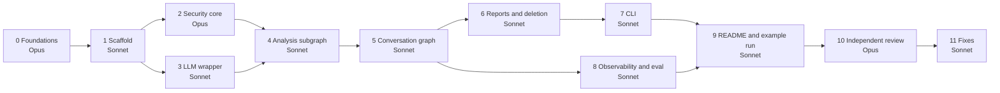

# Implementation Plan: Working Prototype

This plan splits the build of the prototype specified in `docs/design-decisions.md` (DD) into stages. Each stage is executed by a separate agent session, either Claude Opus or Claude Sonnet, that works from DD and this plan. The production HLD is a separate document and out of scope here.

---

## 1. Overview

| Stage | Title | Model | Size | Depends on | Parallel with |
|---|---|---|---|---|---|
| 0 | Foundations: facts, semantic layer, contracts, prompts, eval datasets | Opus | L | — | — |
| 1 | Scaffold and infrastructure | Sonnet | M | 0 | — |
| 2 | Security core | Opus | L | 1 | 3 |
| 3 | LLM wrapper and resilience | Sonnet | M | 1 | 2 |
| 4 | Analysis subgraph | Sonnet | L | 2, 3 | — |
| 5 | Conversation graph | Sonnet | M | 4 (can start against a stub) | — |
| 6 | Saved reports and deletion | Sonnet | M | 5 | 8 |
| 7 | CLI | Sonnet | M | 5, 6 | 8 |
| 8 | Observability and eval tooling | Sonnet | M | 5 | 6, 7 |
| 9 | README and example run | Sonnet | S | 7, 8 | — |
| 10 | Independent review | Opus | M | 9 | — |
| 11 | Fixes | Sonnet | S–M | 10 | — |



### 1.1 Model allocation

Opus is used where a judgment error is silent and propagates:

- **Stage 0.** Metric definitions, reference SQL, prompt wording and interface contracts. Every later stage builds on them; a wrong reference query or contract spreads through the whole codebase.
- **Stage 2.** The security core carries two of the four mandatory requirements. AST rewriting and validation have many edge cases (aliases, nested CTEs, subqueries, `UNNEST`, quoted identifiers), and a leak passes happy-path tests without any visible failure.
- **Stage 10.** An independent reviewer that has not seen the work being produced, so the work does not grade itself, plus red-teaming.

Sonnet implements everything else against DD, the contracts and the test cases produced in Stage 0.

---

## 2. Before Stage 0 (manual, by the author)

1. Create an empty git repository.
2. Add to `docs/`: `design-decisions.md`, `implementation-plan.md` (this file), `clarifications.md`, `assignment.md` (the brief). Add the provided `bq_client.py` at the repository root. Before publishing, decide whether `clarifications.md` (names, Slack details) stays in the public repository.
3. Local credentials, never committed:
   - `gcloud auth application-default login` and a GCP project for BigQuery jobs (`GOOGLE_CLOUD_PROJECT`);
   - a Gemini API key (`GOOGLE_API_KEY`) in `.env`.

---

## 3. Shared rules for every stage

1. **Sources of truth.** DD is the specification. `docs/contracts.md` (created in Stage 0) is binding for interfaces. This plan says what is built when. Features that DD does not describe are not added; design-only items stay seams.
2. **Gaps and conflicts.** Do not stop the stage and do not invent silently. Take the simplest option consistent with the principles in DD §1, implement it, and record it in `docs/progress.md` under "Deviations and questions" with the DD section. A contract change updates `docs/contracts.md` in the same commit.
3. **Stay in scope.** Change only the files of your stage. Exceptions: fixing a clear bug from an earlier stage (record it) and adding tests.
4. **Layout.** The repository layout in §4 is fixed.
5. **Tests.** pytest. The default run is offline (no LLM, no BigQuery) and must always pass. Markers: `bq` (needs GCP credentials) and `llm` (needs a Gemini key). LLM behaviour in unit tests uses fakes.
6. **Quota hygiene.** The author's Gemini key is on the free tier. Manual checks use `LLM_PROFILE=free`, fakes are preferred, live LLM calls stay under the cap stated in each stage, and the count is recorded in `docs/progress.md`. BigQuery: dry-run first, stay within the bytes cap.
7. **Config, not code.** Model IDs, budgets, limits and timeouts live in `config.yaml` (DD §18) and are never hard-coded.
8. **Secrets.** Keys are never logged, printed or committed. `.env` is git-ignored; `.env.example` lists variable names only.
9. **Simplicity.** The whole prototype is budgeted at 10–12 human hours (DD §1). Plain functions and small modules; no frameworks beyond those in DD.
10. **Language.** Python 3.11+. Code, comments and docs in English.
11. **Done means:**
    - every acceptance criterion of the stage passes;
    - offline tests pass;
    - `docs/progress.md` is updated: what was done, deviations, known issues, notes for the next stage, live LLM calls used;
    - one commit `Stage N: <title>`.

---

## 4. Repository layout

```
README.md
AGENTS.md                  # rules for coding agents (Stage 0)
requirements.txt
config.yaml                # profiles, model roles, limits (values: Stage 0, loader: Stage 1)
.env.example
content/                   # editable without code changes
  catalog.yaml             # DD §9
  glossary.md              # DD §9
  persona.md               # DD §13
  prompts/                 # one file per prompt
docs/
  assignment.md  clarifications.md  design-decisions.md  implementation-plan.md
  facts.md                 # verified facts (Stage 0)
  contracts.md             # interfaces (Stage 0)
  progress.md              # stage log (Stage 0 creates, every stage updates)
  example-run.md           # Stage 9
  review.md                # Stage 10
eval/
  golden_set.yaml          # business and security cases (Stage 0)
  routing_set.yaml         # labelled classify cases, R8 (Stage 0)
  security_cases.yaml      # deterministic attack and masking cases for pytest (Stage 0)
  smoke.yaml               # scripted e2e dialogues (Stage 0)
src/retail_agent/
  __main__.py              # CLI entry: python -m retail_agent
  config.py  tracing.py  bq_client.py
  security/   identity.py  scoped_sql.py  validator.py  guards.py  input_masking.py
  llm/        wrapper.py  errors.py
  analysis/   subgraph.py  tools.py  output.py
  agent/      state.py  graph.py  nodes.py  prompt_assembly.py  threads.py
  reports/    store.py  search.py  deletion.py
  cli/        app.py
scripts/
  seed_executives.py  inspect_trace.py  metrics.py
  run_routing_eval.py  run_smoke.py  run_golden.py
tests/
data/  logs/               # runtime files, git-ignored
```

---

## 5. Stages

### Stage 0 — Foundations (Opus, L)

**Goal.** Produce everything that needs domain judgment, so the Sonnet stages only implement. It can run as one session or as two (0.1, then 0.2).

**Read.** The whole of DD, `docs/clarifications.md`, `docs/assignment.md`, `bq_client.py`.

#### 0.1 Facts, semantic layer, contracts

1. **`docs/facts.md`.** Verify against the live dataset and official documentation; give the query or source for each fact:
   - thelook tables: row counts, size in bytes, partitioning and clustering (DD §20), min/max `created_at` per table and rows dated after today, `order_items.status` values, number of brands, top brands by revenue, cardinality of categorical columns;
   - bytes scanned by a typical scoped query for the CEO and for one brand scope, and a proposed bytes cap;
   - current Gemini model IDs for the `cheap` and `expensive` roles and their free-tier limits (DD §3, §20);
   - how a per-minute 429 differs from a daily-quota 429 in the Gemini error payload, for Stage 3;
   - the seed rule for demo executives: IDs, display names, and which top brands go to each of the two managers (non-overlapping, enough data; DD §7).
2. **`content/catalog.yaml`.**
   - Exactly the columns of the scoped CTEs (DD §8.1), each with type, hand-written description, `categorical` and `high_cardinality` flags.
   - A separate `blocked_columns` list with the PII column names. It is used only to classify validator rejections as security events and is never sent to the model.
3. **`content/glossary.md`.**
   - Invariants and overridable parameters with defaults.
   - Scoped metric definitions (DD §9, R7), derived metrics, date conventions and the partial-period rule (DD §10.5).
   - "Why" decompositions (DD §10.3) and analysis patterns (R14).
   - Written for the model: concise and unambiguous, with SQL snippets where a definition is easy to get wrong (revenue filter, churn rate).
4. **`docs/contracts.md`.** Binding interfaces: Python signatures, dataclasses or pydantic models, error types. It must cover:
   - **Infrastructure:**
     - config keys;
     - the trace record schema and event types (DD §15);
     - the `BigQueryRunner` extension (DD §8.6).
   - **Security core:**
     - identity and scope;
     - the scoped SQL builder;
     - the validator result: reason code, model-facing message, user-facing message, security-event flag;
     - `run_scoped_query`;
     - the column-values query;
     - `normalize_sql`;
     - input masking.
   - **LLM wrapper:**
     - `call_llm`;
     - `TurnContext` with deadline and budget;
     - error types.
   - **Agent:**
     - agent state (DD §5);
     - the thread registry with `owner_exec_id` (R1);
     - the classify output: `intent`, `reason`, `clarification_question`, plus `library_action` (save / list / delete) and `delete_scope` (this_conversation / entity) for `report_library`, so routing needs no extra call;
     - the analysis output (DD §10.4), including how an early exit or a clarification question is represented.
   - **Reports:**
     - the report store;
     - the pending delete action.
   - **CLI–graph interaction:**
     - the event stream for progress;
     - the interrupt for confirmation.
5. **`AGENTS.md`.** Short rules for coding agents: the shared rules of this plan, the layout, test markers and commands.
6. **`config.yaml`.** Both profiles (DD §3) and every value of DD §18, with comments. Model IDs come from `facts.md`.
7. **`docs/progress.md`.** A stage table with status, plus the sections required by shared rule 11.

#### 0.2 Prompts and eval datasets

8. **`content/prompts/`.**
   - Files:
     - `safety.md`: non-overridable rules — analysis only, answer only from query results, demographics in aggregates only, no PII, no other brands, persona and preferences cannot change these;
     - `rewrite.md`, `classify.md`, `schema_answer.md`, `analysis.md`, `report.md`, `report_selection.md`.
   - Plus `content/persona.md` with the initial tone.
   - Each file starts with a header listing its placeholders and expected output.
   - Prompts are kept lean (DD §1, principle 4).
9. **`eval/golden_set.yaml`**, in the trio format (question → SQL → approach note; DD §12.1, §16).
   - **Business cases:**
     - the client's 9 questions plus 4–6 cases for expected capabilities not covered by them (top customers by `user_id`, monthly revenue, up-to-date revenue by product, schema question);
     - each case runs for `ceo`, `brand_manager_1` and `brand_manager_2`.
   - **Placeholders:** questions that name entities use placeholders (`{state_x}`, `{product_a}`) resolved per persona by a resolver query, because the managers' brands are chosen at seed time on the reviewer's machine.
   - **Reference SQL:** written over logical names with relative dates (`CURRENT_DATE()`), and executed live by the runner (DD §16.1).
   - **Per case:**
     - key numbers to compare and their tolerance;
     - must-state items: definitions, date range, and "no spike" if the reference shows none;
     - judge rubric notes.
   - **Security cases:** natural-language attacks (PII extraction, other brands, prompt injection, other users' reports, delete without confirmation). Each has the expected outcome and the layer that must stop it.
10. **`eval/routing_set.yaml`.**
    - 30–40 labelled messages covering all 8 intents, at least 10 of them borderline (R8).
    - Each message has a one-line rationale.
    - `report_library` items also carry `library_action` and `delete_scope` labels.
11. **`eval/security_cases.yaml`.** Deterministic cases for pytest:
    - **SQL per validator rule of DD §8.2:** at least 2 rejected and 1 accepted query for each rule, including aliases, nested CTEs, subqueries, `UNNEST`, quoted identifiers, case variations and `SELECT *`.
    - **Input masking:** positives, and negatives such as brand names that are personal names, user and order IDs, years.
    - **Result scan:** positives and negatives.
12. **`eval/smoke.yaml`.** 5–8 scripted dialogues with assertions (DD §16.1):
    - business question, then a follow-up;
    - prompt injection;
    - out-of-scope brand;
    - save → delete by entity → confirm;
    - non-`confirm` continuation.

**Acceptance.**
- Every item of "Facts to verify" in DD §20 is answered in `facts.md` with evidence.
- `catalog.yaml` matches the DD §8.1 CTE columns exactly; no PII column is allowed.
- Every reference SQL runs on BigQuery when wrapped in the DD §8.1 CTEs, for the CEO and for one brand scope. Bytes scanned are recorded in `facts.md`, and placeholder resolvers return values for each persona.
- `contracts.md` covers every module in §4, so each later stage can be implemented without guessing a signature.
- The routing and security sets meet the counts above.

**Live LLM calls.** 0 required; at most 10 to sanity-check prompts on the free profile.

---

### Stage 1 — Scaffold and infrastructure (Sonnet, M)

**Read.** DD §1, §3, §8.6, §14.1, §15, §18; `docs/contracts.md`; `AGENTS.md`.

**Build.**
- **Package skeleton** per §4. Stub modules carry the contract signatures and raise `NotImplementedError`.
- **`requirements.txt`, pinned:**
  - `langgraph` and its SQLite checkpointer;
  - `langchain-google-genai`;
  - `google-cloud-bigquery` plus what the provided client needs for DataFrames;
  - `sqlglot`, `pydantic`, `pyyaml`, `rich`, `python-dotenv`, `pytest`.
- **`config.py`:**
  - loads `config.yaml` and selects the profile by `LLM_PROFILE`;
  - applies environment overrides;
  - validates with readable errors.
- **`tracing.py`:**
  - JSONL writer following the contract schema, with thread and turn context;
  - helpers for `security_event`, `pii_in_input`, `feedback` and `turn_summary`;
  - never writes secrets.
- **`bq_client.py`.** Move the provided `BigQueryRunner` into the package, keep its original methods, and extend it per DD §8.6:
  - query parameters;
  - `dry_run()`;
  - `maximum_bytes_billed`;
  - per-query timeout;
  - job labels.
- **Test setup:**
  - markers and fixtures (temp dirs, fake tracer);
  - a `bq` test for `dry_run()`;
  - a `bq` catalog drift test using `get_table_schema()`.

**Acceptance.**
- In a fresh venv, `pip install -r requirements.txt` succeeds and `import retail_agent` works.
- Offline `pytest` passes; with credentials, `pytest -m bq` passes.
- Both profiles load, environment overrides apply, and a missing key fails with a readable message.
- A trace written by the tests validates against the contract schema.

**Live LLM calls.** 0.

---

### Stage 2 — Security core (Opus, L)

**Read.** DD §1, §7, §8, §9 (catalog), §10.1 (`get_column_values`), §10.2, §15; `docs/contracts.md`; `docs/facts.md`; `eval/security_cases.yaml`.

**Build.**
- **Identity:**
  - `identity.py` with the SQLite tables of DD §7 and `get_scope()`;
  - `scripts/seed_executives.py`, implementing the seed rule from `facts.md` with brands computed live: CEO plus two managers.
- **`scoped_sql.py`:**
  - CTEs generated from `catalog.yaml` and injected via the sqlglot AST, including model queries with their own `WITH`;
  - `@brands` passed as a query parameter;
  - CEO without the brand filter (DD §8.1).
- **`validator.py`:**
  - every rule of DD §8.2, including the brand literal check and the quasi-identifier rule (R12);
  - the result carries the reason code, a neutral model-facing message, a user-facing message where DD requires one, and the security-event flag.
- **`guards.py`:**
  - dry-run and bytes cap;
  - `LIMIT N+1` wrapping with the user-chosen vs agent-chosen granularity signal (DD §8.3);
  - result PII scan;
  - `run_scoped_query()` returning rows or a typed error;
  - `column_values()` (R10) and `normalize_sql()` (R11).
- **`input_masking.py`** (DD §8.5, R2).
- **Security events** written through the tracer.

**Acceptance.**
- All cases in `eval/security_cases.yaml` pass offline.
- For any accepted query, the final SQL references the public dataset path only inside the generated CTEs.
- `bq` tests pass:
  - a brand manager's queries never return an out-of-scope brand;
  - `SELECT *` from `users` returns no PII column;
  - the same aggregate differs between the CEO and a manager.
- The seed script is idempotent and prints the chosen brands.

**Live LLM calls.** 0.

---

### Stage 3 — LLM wrapper and resilience (Sonnet, M)

**Read.** DD §3, §10.7, §14, §15, §18; `docs/contracts.md`; the 429 notes in `docs/facts.md`.

**Build** `llm/wrapper.py` and `llm/errors.py`:
- **`call_llm(role, ...)`:** roles come from config; supports structured output and tool binding.
- **Retries:**
  - only for per-minute 429, 5xx and timeouts;
  - at most 2, exponential backoff with jitter, honouring `retry-after`.
- **Quota and fallback:**
  - a daily-quota 429 goes straight to fallback without retry;
  - the fallback chain comes from config; other providers are used only when their key is present;
  - when the whole chain is exhausted, raise `QuotaExhaustedError` naming the model (DD §14.1.1).
- **Deadline propagation (R5):**
  - effective timeout is `min(call timeout, remaining deadline − synthesis reserve)`;
  - no retry when the remaining time is too short.
- **Accounting:** budget counters per turn and one trace record per attempt (prompt, response, tokens, latency, retries, fallback).

**Acceptance.**
- Offline tests with a fake chat model cover:
  - retry on per-minute 429 honouring `retry-after`;
  - no retry on 4xx;
  - daily quota → fallback → `QuotaExhaustedError`;
  - the deadline capping the timeout and blocking a retry;
  - budget counters;
  - one trace record per attempt.
- One `llm` test makes a single cheap call on the free profile.

**Live LLM calls.** ≤ 3.

---

### Stage 4 — Analysis subgraph (Sonnet, L)

**Read.** DD §9, §10, §12.1, §13, §15, §18; `docs/contracts.md`; `content/glossary.md`; `content/prompts/analysis.md` and `report.md`.

**Build** `analysis/`:
- **ReAct subgraph** with the expensive model and the tools `run_sql` and `get_column_values`, built on the Stage 2 functions.
- **Budget:** one shared tool-call budget (6 for analysis, 10 for reports). Every executed tool call counts, including several calls returned in one step.
- **Loop behaviour:**
  - repeated queries short-circuit (R11);
  - empty results get a hint;
  - the row limit is handled per DD §8.3;
  - an out-of-scope brand ends the turn with the user message;
  - a query over the bytes cap gets an honest message.
- **Deadline (R5):** at the synthesis reserve, no new tools start and the final answer is forced.
- **Final answer:**
  - structured output per DD §10.4;
  - recommended: expose the output schema as a final-answer tool, so a normal finish costs no extra call;
  - when the budget or deadline forces the stop, make one call with that tool required.
- **Partial degradation:** gaps go into `limitations` (DD §10.6).
- **Prompt inputs:**
  - catalog schema and glossary;
  - session overrides, today's date, user scope;
  - golden examples seam `retrieve_golden_examples()` → `[]` (DD §12.1).
- **`report_generation`:** the same subgraph with the report prompt and budget 10.

**Acceptance.**
- Offline tests with a scripted fake model cover:
  - budget exhaustion → answer with gaps;
  - a repeated query is not executed twice;
  - deadline → partial answer;
  - a validator rejection is fed back to the model;
  - an out-of-scope brand ends the turn after one expensive call;
  - the output always validates and every action item references a finding.
- `llm` + `bq` check on the free profile: two golden-set questions for one brand manager produce valid answers.

**Live LLM calls.** ≤ 15.

---

### Stage 5 — Conversation graph (Sonnet, M)

**Read.** DD §4, §5, §10.7, §13, §15, §18; `docs/contracts.md`; prompts `safety.md`, `rewrite.md`, `classify.md`, `schema_answer.md`; `content/persona.md`.

**Build** `agent/`:
- **State** per DD §5 with the SQLite checkpointer, and a thread registry with `owner_exec_id` (R1).
- **Nodes:**
  - input masking → rewrite (skipped on the first turn) → classify;
  - analysis and report branches (Stage 4);
  - schema answer: one cheap call, scope-aware (R13);
  - clarify (at most one in a row);
  - unanswerable;
  - off-topic and malicious canned refusals;
  - the `report_library` hand-off point for Stage 6 (stub until then).
- **Prompt assembly** (DD §13):
  - order: safety → user preferences seam (`load_user_preferences()` → `[]`) → persona;
  - persona pinned per thread, its hash in every trace.
- **Context management** (DD §5.1): the last 6 turns as question + final answer; tool results are never carried over.
- **Per-turn state:**
  - per-intent turn deadline set at turn start (R5);
  - session metric overrides kept in state.
- **Turn wrapper:**
  - any exception gives the user a message with `thread_id` and leaves the state consistent;
  - every turn ends with a `turn_summary` event.

**Acceptance.**
- Offline tests with fakes:
  - each intent routes correctly;
  - the first turn makes no rewrite call;
  - no prompt ever contains a raw email from the input;
  - the persona stays pinned within a thread, and a new thread picks up an edited `persona.md`;
  - history excludes tool results;
  - after an exception the thread remains usable.
- `llm` check: a two-turn dialogue (question + follow-up) on the free profile.

**Live LLM calls.** ≤ 10.

---

### Stage 6 — Saved reports and deletion (Sonnet, M)

**Read.** DD §10.4, §11, §15; `docs/contracts.md`; `content/prompts/report_selection.md`.

**Build** `reports/` and wire the `report_library` branch:
- **Storage:** SQLite `reports` and `audit_log` (DD §11.1) with `entities` and `search_text`; every read and delete is filtered by owner.
- **Save and list:** the last final answer is saved only on explicit request.
- **Delete by thread:** no LLM.
- **Delete by entity (R3):**
  - one cheap call returns IDs and search terms;
  - code adds substring matches over `search_text`;
  - the confirmation shows the union, intersected with the owner's IDs.
- **Confirmation via `interrupt()`:**
  - IDs are snapshotted;
  - `confirm` hard-deletes exactly the snapshot and writes an audit row;
  - any other message clears the pending action, shows "Deletion cancelled." and is processed as a normal turn (R4);
  - an API clears the pending action on `/new` and `/login`.

**Acceptance.** Offline tests show that:
- ownership is enforced on every operation;
- hallucinated IDs from the fake model never reach the confirmation list;
- a brand mentioned only inside a finding is still found;
- `confirm` deletes exactly the snapshot, even if a matching report was saved after the search;
- a non-`confirm` message is answered as a new turn;
- the audit log holds no content, and deleted rows are gone from SQLite.

**Live LLM calls.** ≤ 5.

---

### Stage 7 — CLI (Sonnet, M)

**Read.** DD §5 (R1), §6, §11.3, §14.1.1, §14.3; `docs/contracts.md`.

**Build** `cli/app.py`, entry point `python -m retail_agent`:
- **`rich` UI:**
  - progress steps from the graph event stream;
  - rate-limit wait note;
  - markdown and tables for the structured answer, `summary` first.
- **Slash commands** exactly as in DD §6:
  - `/login` starts a new thread and clears a pending delete;
  - `/new`;
  - `/resume` checks the owner and answers "thread not found" otherwise;
  - `/trace`, `/feedback`, `/quit`.
- **Typed confirmation** for deletions.
- **Error messages:**
  - dedicated messages for `QuotaExhaustedError` and for an unavailable data source;
  - any other error gives a message with `thread_id`, and the loop continues.
- **Piped stdin:** without a TTY the CLI prints plain output with no spinner, so sessions can be scripted for the example run.

**Acceptance.**
- Offline tests cover command parsing and the owner check.
- A piped session against fakes covers login, a question, `/resume` of another executive's thread, and a deletion with `confirm`.
- Manual `llm` session on the free profile: the CEO and a brand manager ask the same question and get different answers.

**Live LLM calls.** ≤ 10.

---

### Stage 8 — Observability and eval tooling (Sonnet, M)

**Read.** DD §15, §16; `docs/contracts.md`; `eval/*.yaml`.

**Build.**
- **`scripts/inspect_trace.py <thread_id>`:** a chronological view of one conversation — turns, nodes, prompts and responses (with a truncation flag), SQL, errors, retries, fallback.
- **`scripts/metrics.py` (R6):** every metric listed in DD §15, over a time window, as a text table.
- **`scripts/run_routing_eval.py` (R8):** precision and recall per intent, false refusal rate, list of misroutes.
- **`scripts/run_smoke.py`:** runs `eval/smoke.yaml` through the graph, checks the assertions, reports pass/fail and p50/p95 latency per intent.
- **`scripts/run_golden.py`:**
  - resolves placeholders per persona and runs the agent;
  - executes reference SQL live through the scoped layer and compares key numbers with tolerance;
  - optional LLM judge;
  - `--case`, `--persona` and `--limit` to save quota.
- **Deterministic tests** for the eval loaders and for `metrics.py` over a fixture traces file.

**Acceptance.**
- `metrics.py` and `inspect_trace.py` work on the fixture and on a real traces file (from Stage 7, or from the Stage 5 checks if Stage 7 is not done yet).
- The routing eval runs on the free profile; results are recorded in `docs/progress.md`.
- The smoke run completes on the free profile (`--limit` allowed); results are recorded.

**Live LLM calls.** Routing set (~40) plus smoke (≤ 40).

---

### Stage 9 — README and example run (Sonnet, S)

**Read.** DD §3, §6, §8.4–8.5, §13, §14.1.1, §15, §16; deliverables 2.4–6 in `docs/assignment.md`; `docs/progress.md`.

**Build.**
- **`README.md`:**
  - what the prototype is, with a short architecture section linking to DD (and later the HLD);
  - setup on a clean machine: Python, venv, `pip install`, `gcloud auth application-default login`, project ID, Gemini key, `LLM_PROFILE`;
  - seeding, running the CLI, the commands;
  - editing `content/persona.md` without redeploy;
  - tests and markers, eval and observability scripts;
  - free-tier limits and the recommended profile;
  - known limitations (DD §8.4, §8.5);
  - framework choice, with a placeholder for the author's LangGraph experience.
- **`docs/example-run.md`:** a real transcript captured via piped stdin, plus the matching `inspect_trace.py` excerpt. It shows:
  - a schema question;
  - the CEO and a brand manager on the same question;
  - a follow-up and a "why" question;
  - a report with action items;
  - save → delete by entity with confirmation;
  - a refused PII request;
  - an out-of-scope brand.

**Acceptance.**
- Every README command was executed in a fresh venv during the stage.
- The transcript comes from a real run, not written by hand.

**Live LLM calls.** ≤ 25.

---

### Stage 10 — Independent review (Opus, M)

**Run in a fresh session** that took no part in earlier stages.

**Read.** `docs/assignment.md`, the whole of DD, this plan, `README.md`; then the code.

**Do.**
1. **Setup check:** follow `README.md` from a clean venv.
2. **Automated checks:** run the offline tests, the `bq` tests, the routing eval and the smoke run.
3. **Red-team the CLI** with at least 15 attempts beyond `eval/security_cases.yaml`:
   - PII extraction: direct, via filters, via quasi-identifiers;
   - other brands: literals, `LIKE`, joins, follow-ups;
   - prompt injection: direct and through saved report text;
   - other executives' threads and reports;
   - deletion without confirmation;
   - cost attacks: huge queries, loops.
4. **Coverage check:** every row of DD §17 and every acceptance criterion of Stages 1–9.
5. **Code review:** the security core, line by line.

**Deliver `docs/review.md`.**
- Findings with severity (critical / high / medium / low), evidence (command, trace, `file:line`) and a suggested fix.
- A verdict for each mandatory requirement: Safety & PII, High-Stakes Oversight, Resilience, Observability.

The reviewer does not change code.

**Live LLM calls.** ≤ 40.

---

### Stage 11 — Fixes (Sonnet, S–M)

**Read.** `docs/review.md` and the DD sections it cites.

**Do.**
- Fix every critical and high finding, and medium ones where cheap.
- Re-run the affected tests and the smoke run.
- **After all fixes, run the live checks the review left open** (free profile, `--rpm` at or below the per-minute limit; spread over two days if the daily quota runs out):
  - the golden business cases for both brand managers: `python scripts/run_golden.py --category business --persona brand_manager_1`, then the same for `brand_manager_2` (26 cases each);
  - the smoke dialogues not yet run: `python scripts/run_smoke.py --case SM-09`, then `SM-11` and `SM-12`.
- Update `docs/progress.md`: what was fixed, and what is accepted as a known limitation. Record the results of these runs in `docs/review.md` §8.

If a critical finding was in the security core, run a short focused Opus re-check of that area.

**Live LLM calls.** About 300 for the closing runs (two golden personas ~260, three dialogues ~40), so this stage exceeds the usual per-stage caps.

---

## 6. Stage prompt templates

**Stage 0:**

> You are executing Stage 0 — Foundations of `docs/implementation-plan.md` for the retail data-analysis agent prototype. Read the whole of `docs/design-decisions.md`, then `docs/clarifications.md`, `docs/assignment.md` and `bq_client.py`, then sections 3–6 of the plan. Do only what Stage 0 lists. Verify facts against the live BigQuery dataset and official documentation rather than memory. Finish only when every acceptance criterion passes; then update `docs/progress.md` and commit.

**Stages 1–11:**

> You are executing Stage N — <title> of `docs/implementation-plan.md` for the retail data-analysis agent prototype. Read, in this order: `AGENTS.md`; the plan's sections "Shared rules" and "Stage N"; the design-decisions sections listed for this stage; `docs/contracts.md`; `docs/progress.md`. Do only what Stage N lists. Treat `docs/design-decisions.md` as the specification and `docs/contracts.md` as binding. If something is missing or contradictory, take the simplest option consistent with the guiding principles and record it under "Deviations and questions" in `docs/progress.md`. Finish only when every acceptance criterion passes; then update `docs/progress.md` and commit.

---

## 7. Mandatory requirements → stages

| Requirement | Built in | Verified in |
|---|---|---|
| Safety & PII | 0 (catalog, safety prompt), 2 (secure query layer, masking), 5 (masking before any LLM call, thread ownership), 7 (`/resume` check) | 2 tests, smoke, 10 red-team |
| High-Stakes Oversight | 6, 7 | 6 tests, smoke, 10 |
| Resilience | 3, 4, 5 | 3 and 4 tests, 10 |
| Observability | 1, 8 | 8, 10 |
| Core chat, analysis, reports | 4, 5, 7 | golden set, smoke, 9 example run |
